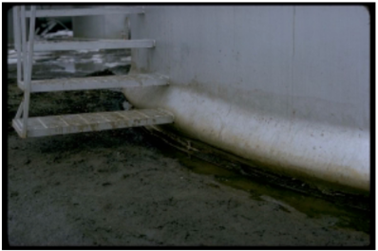

## **1 - BASE DE DATOS**

Los datos sobre los tanques, objeto de análisis, se extrajeron de
informes realizados durante los años 2015 al 2022, los cuales se
encontraban clasificados según el tipo de auditoría realizada.

En algunos casos, las auditorías técnicas son de condición interna ó
externa, de control, de medición, de mantenimiento y en otros, se trata
de auditorías ambientales, de seguridad, de asentamiento, de abandono de
uso de tanques o de reparación, involucran variables ambientales, que
tratan, el entorno del tanque y/o la infraestructura existente en los
alrededores. El criterio de inclusión de los tanques en la base de datos
es que sul volumen sea mayor o igual a 500m3, priorizando aquellos
tanques, que, por su escala operativa, representan un mayor riesgo
potencial y mayor probabilidad de daños.

A continuación, se explican los parámetros observados de las auditorias.

### Información Disponible

CLASIFICACION DE LA INFORMACION

Los informes disponibles se clasificaron por número de documento y por
año, de la siguiente manera:

ID: número de reporte de tanque

OAT: Numero de informe

Año de informe

### OAT/CIT

El número CIT permite reconocer el tanque dentro del sistema de la base
de datos de la organización que realiza las auditorias. En este caso, el
número de OAT, es la identificación interna para determinar el origen de
la información (número de informe/año de informe).

### Ubicación (Lat/Long)

La ubicación es importante a la hora de reconocer el tipo de clima al
que se encuentra expuesto el tanque, como lo es por ejemplo la velocidad
del viento a la que tiene que resistir. De la misma manera, el efecto
del sismo, el tipo de suelo, la intensidad de lluvia, etc. Estas
representan cargas externas, para lo cual la infraestructura debe estar
preparada para soportar y seguir en servicio.

### Estado

Esta variable, permite conocer la situación del tanque, ya que implica,
un escenario de carga y una condición de contorno diferente para la
estabilidad del tanque.

En operación, se puede considerar la condición de máxima presión
hidrostática, asumiendo para este estado como un tanque lleno. Como
señala Herrera (2007) en su documento, el líquido genera presiones que
ante un sismo, puede aumentar el riesgo de pandeo de pata de elefante en
la base, por superarse el límite crítico si el tanque es esbelto, H/D \>
0.7. En la condición de vacío, el tanque es mas liviano y mucho mas
vulnerable al viento. Por lo tanto, la relación de esbeltez también
incide en una posible falla de pandeo por presión externa, lo cual se
agrava, si el tanque no se encuentra rigidizado correctamente. La
condición de abandono, determina que el tanque se encuentra listo para
su reemplazo o que ha terminado su vida útil dentro de la planta o
batería a la que pertenece. Sin embargo, cuando estos activos están
presentes dentro de la infraestructura, existe un mayor riesgo de fallas
catastróficas, debido a el avance de la corrosión que pueden tener, o al
debilitamiento de sus componentes estructurales. Como consecuencia,
mayor riesgo de daños en tanques cercanos que se encuentren en
operación.

### Producto

Saber el producto que almacena un tanque es de gran importancia para
realizar un análisis preciso de riesgos. Esto incluye comprender sus
propiedades físicas y químicas, como la densidad, la volatilidad, la
inflamabilidad y la toxicidad. Estos datos son esenciales para evaluar y
mitigar posibles riesgos de seguridad, protección ambiental, y salud
publica asociados con el almacenamiento y manipulación del producto. Es
posible determinar el impacto que tiene la llama en función del tipo de
combustible que participe en algún evento de explosión o incendio que
involucre baterías de tanques, o plantas de refinerías. Por otro lado,
según el trabajo de Herrera (2007), se menciona que el daño depende de
las presiones hidrodinámicas, por lo tanto, el tipo de fluido define la
masaoscilante máxima posible. Un fluido más denso incrementará las
presiones de confinamiento y las fuerzas de inercia ante un sismo,
aumentando la probabilidad de llegar al estado de "pata de elefante"
incluso si el tanque no está al 100% de su capacidad. Los fluidos más
pesados, y densidades más altas, requieren mayor esfuerzo de corte en la
base y por lo tanto, mayor carga que podría desencadenar en mayor
probabilidad de asentamientos. Fluidos más livianos o refinados, aunque
tengan menor densidad, presentan tanques con mayor riesgo de incendio y
por otro lado, de volcamiento, si no se encuentran anclados.

### Prop. Físicas

VOLUMEN/ALTURA/DIAMETRO/ESPESORES

Aspectos como el tamaño, la forma, el espesor de las paredes y la
ubicación de las soldaduras tienen un impacto directo en como se
distribuyen las cargas y las tensiones dentro del tanque.  Además de la
evaluación de la resistencia se evalúan las deformaciones que se
producen en función de la geometría del tanque frente a solicitaciones
externas, como se puede observar según Daño sísmico de tanque de acero
(Juan Carlos Herrera, 2007). En dicho trabajo, se plantean los daños que
se observaron en distintos eventos sísmicos y el análisis del parámetro
H/D como predictor de modos de falla. Tanques esbeltos H/D \> 0,7 son
tanques mucho más vulnerables a grandes esfuerzos de compresión en la
base, generando pandeo “pata de elefante” (Figura 6‑4).

{fig-align="center"}

*Figura 6‑4: Pandeo “pata de elefante” de la pared. Alaska-1964. (Juan
Carlos Herrera, 2007)*

Es fundamental aclarar que la relación entre la esbeltez y el volumen de
los tanques no es lineal. La probabilidad de que un tanque sufra un daño
severo (DS-4 o DS-5) aumenta considerablemente a medida que se
incrementa la relación H/D. Un tanque que es tanto de gran volumen como
esbelto enfrenta un riesgo estructural mucho mayor en comparación con
uno que tiene el mismo volumen pero un diámetro más amplio.

### Año de Montaje

Conocer el año de montaje permite determinar la edad del tanque y los
años en servicio. Una función importante de analizar, podría ser los
daños más frecuentes en base a los años en servicio. Como lo es, la
corrosión del metal ya que se trata de un proceso de degradación con el
paso del tiempo. Conocer si el tanque cumple o no con las regulaciones
vigentes, analizar la evolución de los estándares de diseño, realizar
análisis de seguridad ya que tanques más antiguos pueden tener más
problemas de corrosión o desgaste que podrían comprometer su integridad.
Por otro lado, la edad del tanque permite planificar el tipo de
mantenimiento necesario para garantizar la seguridad y el cumplimiento
normativo de las instalaciones petroleras. Por otro lado, tanques de
mayor edad, han pasado por más ciclos de llenado y vaciado, lo que suele
derivar en asentamientos diferenciales.

### Empresa

Conocer la empresa, puede dar información de la distribución de los
tanques según se trate de una operadora, o una planta como una
refinería. En el caso de un tanque con mayor vulnerabilidad estructural,
y que se encuentre en una infraestructura densamente poblada, puede
provocar una falla o un colapso, ocasionando un desastre en cadena. El
tamaño y tipo de empresa, puede correlacionarse con el rigor de sus
programas de mantenimiento, parques más grandes de activos, suelen tener
protocolos de inspección muy estrictos y presupuestos asignados para
reparaciones preventivas. A veces empresas más pequeñas o de servicios,
operan con márgenes de inversiones más ajustados.

### Nomenclatura

NOMENCLATURA DEL TANQUE/NOMBRE DE INFORME INTERNO/TIPO DE INFORME

La nomenclatura es parte de la identificación del tanque y el nombre del
informe interno para tener trazabilidad de la información extraída.

### Virolas

ESPESOR PRIMER VIROLA (`e_espesor1er_virola`)

El espesor influye en la resistencia del tanque frente a la acción
externa sobre su superficie. A partir del espesor de la primera virola,
se puede determinar el resto de los espesores a través del “Método de un
Pie” para tanques de diámetro menores a 60m. Este valor es importante,
debido a que la primer virola es la que recibe mayor presión y
relacionando esto con la edad del tanque, es posible analizar la perdida
de integridad del tanque. Por otro lado, también es la que recibe mayor
carga vertical y esto para tanques esbeltos H/D \> 0.7, según Herrera
(2007), produce mayor riesgo de pandeo.

CANTIDAD DE VIROLAS (`e_virolas`)

Conocer la cantidad de virolas, ayuda a comprender la capacidad de
almacenamiento, estabilidad estructural, además facilita la inspección y
el mantenimiento adecuado. Además un tanque con bastantes virolas
cortas, exhibe un comportamiento levemente diferente al de uno con
escasas virolas más altas ante fenómenos de abolladura.

### Resultado del informe

Esta información permite conocer las tareas a realizarse en el tanque,
en función del resultado de la auditoria. Así se puede extrapolar la
vida útil remanente del tanque, conocer los procesos de mantenimiento
y/o reparación aplicados, conocer la eficiencia operativa y la
fiabilidad de las instalaciones de almacenamiento de productos
almacenados.

### Diques de Contención

DC-INDIVIDUAL/COMPARTIDO/DIMENSIONES

Los diques de contención son parte de la infraestructura de los tanques
y forman parte de un requisito obligatorio. Desde un punto de vista
ambiental interesa conocer el estado de dicha contención o su existencia
frente a la posibilidad de derrames, y/o protección de la
infraestructura circundante. Por otro lado, frente a la acción del
viento, es posible estudiar el efecto que tienen estas estructuras en
como pantallas frente a la superficie de un tanque.

|  |  |
|----|----|
| {width="271"} | {width="312"} |

*Figura 6‑6a: A la izquierda, lay out en imagen satelital. A la derecha,
imagen de interior del recinto de contención*

### Tipo de Techo

El tipo de techo puede afectar la seguridad operativa del tanque, los
techos flotantes son más propensos a problemas como la acumulación de
gases inflamables debajo del techo. Algunos tipos de techos son más
adecuados para ciertos tipos de productos petrolíferos ligeros, mientras
que los techos fijos pueden ser más adecuados para productos más pesados
o viscosos. Por otro lado, el tipo de techo puede influir en los
requisitos de mantenimiento y reparación del tanque. Los techos
flotantes pueden requerir inspecciones más frecuentes y mantenimiento
especializado. El tipo de techo influye en el comportamiento estructural
del tanque frente a acciones térmicas, ya que estas generan muchas
deformaciones. También frente a la acción del viento sobre la corona del
tanque, y por otro lado, en tanques bajos (H/D \< 0.7), según las curvas
de fragilidad del documento (Figura 8). Daño sísmico de tanque de acero
(Juan Carlos Herrera, 2007), se demostró que son más propensos a
problemas de *sloshing* (oleaje) afectando la estructura del techo.

### Corrosión y Asentamientos

MEDICION DE CORROSION/MEDICION DE ASENTAMIENTOS

La corrosión puede comprometer la integridad estructural del tanque, por
ello, conocer la existencia de estas mediciones puede colaborar en el
desarrollo de medidas preventivas, correctivas, teniendo en cuenta las
consecuencias y el estado operativo del tanque.

Los asentamientos pueden indicar problemas de la base del tanque, como
la compactación del suelo o falta de capacidad de carga. Conocer la
magnitud y la naturaleza de los asentamientos es esencial para evaluar
la integridad estructural del tanque.  También, se puede comprometer la
estabilidad del tanque y aumentar riesgo de falla estructural, incluido
vuelco o deformaciones excesivas. También los asentamientos
diferenciales pueden causar tensiones de deseadas en las soldaduras y
juntas del tanque, lo que aumenta el riesgo de fugas y derrames

### Comentarios y Adjuntos

En este ítem se pretende resaltar información que pueda ser de utilidad,
o aporte mayor claridad a la base de datos, de manera visual o
descriptiva. En algunos casos, se adjuntan imágenes, croquis de
ubicación y de geometrías.

## **2 - EDA**

ANALISIS EXPLORATORIO DE DATOS

### Lectura de los datos

Se comienza importando los datos y cargando las librerías a utilizar en
el informe. Se utilizará como marco de referencia el entorno de
tidyverse.

```{r, ECHO=FALSE, warning=FALSE, message=FALSE, results='hide'}
library(tidyverse)
library(readxl)
library(janitor)
library(skimr)
library(naniar)
library(lubridate)

# Se eliminan variables previas en la sesión
rm(list=ls())

# Lectura del xml
tanques <- read_excel("Datos/Datos_Tanques.xlsx") %>%
  clean_names()

```

### Inspección visual

Se realiza una inspección visual inicial de los datos para observar
tipos de variables y datos faltantes.

```{r}
print(tanques)
```

Son 263 individuos (tanques) a los que se les observaron 27 variables. A
priori se estima que hay muchos valores faltantes.

### Valores faltantes

En la inspección visual se observa una gran cantidad de datos faltantes
distribuidos en todas las variables, por lo que se procede a identificar
la cantidad de valores faltantes.

```{r}
# Variables con la mayor cantidad de datos faltantes
tanques |> 
  summarise(across(everything(),
                   ~ sum(is.na(.)))) |> 
  pivot_longer(everything(),
               names_to = "variable",
               values_to = "faltantes")  |> 
  arrange(desc(faltantes)) |> 
  head()

# Cantidad total de valores faltantes
tanques |> summarise(across(everything(),
                 ~ sum(is.na(.)))) |> sum()
```

Se observa que la variable `dc_compartido` (que indica si se compartió
información sobre los diques de contención) es la que mayor cantidad de
datos faltantes posee, luego `comentarios` (comentarios del inspector
sobre el informe de auditoría) y en tercer lugar `dc_dimensiones`.
También entra en el top 6 la variable `dc_individual`.

Como los diques de contención son construcciones con el objetivo de
salvaguardar el medioambiente y no forman parte de las propiedades
físicas del tanque, y dado que es el punto donde más datos faltantes se
observan (344 *NA* entre las 3), no se utilizará información sobre los
diques de contención en el análisis.

```{r}
#| include: false
# se eliminan las variables a no utilizar luego del analisis de datos faltantes
tanques <- tanques |> select(!(c(dc_compartido, 
                                 comentarios,
                                 dc_dimensiones,
                                 dc_individual)))

```

### Tipo de datos

Revisamos que las variables esten almacenadas con el tipo de dato que
corresponde:

```{r}
#| echo: false

tipos_datos <- tibble(
  variable = names(tanques),
  tipo = sapply(tanques, class)
)

tipos_datos
```

Todas las variables se clasificaron en *numeric* o *character*.

Las variables *cuantitativas* están correctamente almacenadas como
*numeric* y no hace falta convertirlas:

```{r}
tipos_datos |> filter(tipo == "numeric")
```

Pero si bien `id` es un número, será utilizado como etiqueta, por lo que
la convertiremos a *character*:

```{r}
# Se convierte id a factor
tanques <- tanques |> 
  mutate(id = as_factor(id))


# Se actualizan los tipos de datos
tipos_datos <- tibble(
  variable = names(tanques),
  tipo = sapply(tanques, class)
)
```

Vemos las *cualitativas*:

```{r}
#| echo: false
tipos_datos |> filter(tipo == "character")
```

Descartamos las siguientes variables del análisis:

- `oat`, `cit` y `taah` porque son etiquetas identificatorias y
  utilizaremos `id` como identificador del tanque.

- `ubicacion` debido a que su información ya se encuentra con precisión
  en las variables `long` y `lat`.

- `archivo_doc`, `adjuntos` y `tipoinforme` por el hecho de que este
  estudio se centra unicamente en las propiedades físicas de los tanques
  y estas variables no aportan información utlizable.

```{r}
#| include: false
# se eliminan las variables cualitativas a no utilizar
tanques <- tanques |> select(!(c(oat,
                                 cit,
                                 taah,
                                 ubicacion,
                                 archivo_doc,
                                 adjuntos,
                                 tipoinforme)))
```

Convertimos las variables `estado`, `tipo_de_techo`, `resultado_informe`
a categóricas:

```{r}
#| include: false
# variables tipo character a factores
tanques <- tanques |> 
  mutate(
    estado = as.factor(estado),
    tipo_de_techo = as.factor(tipo_de_techo),
    resultado_informe = as.factor(resultado_informe)
  )

```

Convertimos las variables dicotómicas `medicion_de_asent_dif` y
`medicion_de_corrosion` a logicas.

```{r}
#| include: false
# variables tipo character a tipo lógicas
tanques <- tanques |> 
  mutate(
    medicion_de_asent_dif = case_when(
      medicion_de_asent_dif == "SI" ~ TRUE,
      medicion_de_asent_dif == "NO" ~ FALSE,
      is.na(medicion_de_asent_dif) ~ NA
    ),
    medicion_de_corrosion = case_when(
      medicion_de_corrosion == "SI" ~ TRUE,
      medicion_de_corrosion == "NO" ~ FALSE,
      is.na(medicion_de_corrosion) ~ NA
    )
  )
```

Se debe corregir la variable `producto` ya que por falta de criterios de
estandarización en la toma de datos tiene muchos valores diferentes para
indicar lo mismo, por ejemplo, se observa "AGUA + PETROLEO" y también
"PETROLEO + AGUA" o "AGUA CON PETROLEO", etc.

Visualizando los valores que toma la variable identificamos que algunas
categorias presentan muchas observaciones, como por ejemplo:

- AGUA

- PETROLEO

- PETROLEO + AGUA

- GAS OIL, etc

Por lo que a ellas las dejamos y solo estandarizamos el nombre.

Luego vemos que hay mucha diversidad de productos. En vez de agruparlos
a todos juntos en una categoría "OTROS", los agrupamos por su densidad
ya que esta propiedad es muy importante para entender las cargas del
producto sobre las paredes de los tanques. Las categorías son:

- LIVIANOS (\~0.65–0.75 g/cm³)

- INTERMEDIOS (\~0.78–0.83 g/cm³)

- PESADOS (\~0.83–0.95 g/cm³)

A los restantes los agrupamos en OTROS por no tener información sobre
ellos o por no poseer más de una o dos observaciones.

```{r}
#| message: false
#| warning: false
#| include: false
# Hay 145 valores unicos en la variable producto
unique(tanques$producto)

# Hay que hacer una tabla de equivalencias para estandarizar nombres y agrupar
dicc <- c(
  "Agua" = "AGUA",
  "AGUA DULCE" = "AGUA",
  "Agua de Inyección"   = "AGUA",
  "Agua de formación" = "AGUA",
  "Agua de formacion" = "AGUA",
  "Agua de Formacion" = "AGUA",
  "Agua de Formación" = "AGUA",
  "AGUA DE FORMACIÓN" = "AGUA",
  "AGUA DE FORMACION" = "AGUA",
  "AGUA Y CONDENSADOS" = "AGUA",
  "Agua de producción" = "AGUA",
  "AGUA HIDROCARBURADA" = "AGUA",
  "Agua hidrocarburada" = "AGUA",
  "Agua Hidrocarburada" = "AGUA",
  "Agua Hidrocarburada." = "AGUA",
  "AGUA CON HIDROCARBURO" = "AGUA",
  "Almacenado: Agua de producción" = "AGUA",
  "AGUA TRATADA" = "AGUA",
  "Aguas Agrias" = "AGUA",
  
  "PETROLEO TRATADO" = "PETROLEO",
  "Petroleo" = "PETROLEO",
  "Petróleo" = "PETROLEO",
  "Pétroleo" = "PETROLEO",
  "PETRÓLEO" = "PETROLEO",
  "PETROLEO\r\r\nPETRÓLEO" = "PETROLEO",
  "Crudo en especificación" = "PETROLEO",
  "CRUDO EN PROCESO" = "PETROLEO",
  "CRUDO" = "PETROLEO",
  "Crudo" = "PETROLEO",
  "CRUDO DE PETROLEO" = "PETROLEO",
  "PETROLEO CRUDO" = "PETROLEO",
  "PETRÓLEO CRUDO" = "PETROLEO",
  "Petróleo crudo" = "PETROLEO",
  "Almacenamiento de Crudo en especificación"= "PETROLEO",
  
  "PETRÓLEO/AGUA" = "PETROLEO + AGUA",
  "PETROLEO/AGUA" = "PETROLEO + AGUA",
  "Petroleo/Agua" = "PETROLEO + AGUA",
  "Petróleo + Agua" = "PETROLEO + AGUA",
  "Petroleo + Agua" = "PETROLEO + AGUA",
  "AGUA Y PETROLEO" = "PETROLEO + AGUA",
  "AGUA Y PETRÓLEO" = "PETROLEO + AGUA",
  "Agua + Petroleo" = "PETROLEO + AGUA",
  "Agua + Petróleo" = "PETROLEO + AGUA",
  "AGUA + PETROLEO" = "PETROLEO + AGUA",
  "AGUA + PETRÓLEO" = "PETROLEO + AGUA",
  "HIDROCARBURO Y AGUA DE FORMACION" = "PETROLEO + AGUA",
  "Agua/crudo" = "PETROLEO + AGUA",
  "Agua/Petroleo" = "PETROLEO + AGUA",
  "PETROLEO y AGUA" = "PETROLEO + AGUA",
  "Petróleo Hidratado" = "PETROLEO + AGUA",
  "petróleo y agua" = "PETROLEO + AGUA",
  "Petróleo y agua" = "PETROLEO + AGUA",
  "PETROLEO Y AGUA" = "PETROLEO + AGUA",
  "PETROLEO / AGUA FORMACION" = "PETROLEO + AGUA",
  "PETROLEO CON AGUA" = "PETROLEO + AGUA",
  "CRUDO HIDRATADO" = "PETROLEO + AGUA",
  "Crudo Hidratado" = "PETROLEO + AGUA",
  "PETROLEO HIDRATADO" = "PETROLEO + AGUA",
  "Petróleo / Agua" = "PETROLEO + AGUA",
  "AGUA CON PETRÓLEO" = "PETROLEO + AGUA",
  "AGUA-PETROLEO" = "PETROLEO + AGUA",
  "AGUA+PETROLEO" = "PETROLEO + AGUA",
  "AGUA E HIDROCARBUROS" = "PETROLEO + AGUA",
  "Agua e Hidrocarburo" = "PETROLEO + AGUA",
  "Petróleo y agua)" = "PETROLEO + AGUA",
  "Agua y crudo en especificación" = "PETROLEO + AGUA",
  "PETROLEO AGUA" = "PETROLEO + AGUA",
  "Agua de producción y crudo" = "PETROLEO + AGUA",
  "PETROLEO-AGUA" = "PETROLEO + AGUA",
  "PETR+AGUA" = "PETROLEO + AGUA",
  "PETROLEO + AGUA." = "PETROLEO + AGUA",
  "PETROLEO+AGUA" = "PETROLEO + AGUA",
  "Agua + Petróleo." = "PETROLEO + AGUA",
  
  "GASOLINA"  = "GAS OIL",
  "BIODIESEL"  = "GAS OIL",
  "DIESEL MARINO"  = "GAS OIL",
  "Gas oil"  = "GAS OIL",
  "Gas Oil"  = "GAS OIL",
  "GAS OIL"  = "GAS OIL",
  "Gasoil"  = "GAS OIL",
  "Infinia Diesel"  = "GAS OIL",
  "Gasolina Estabilizada."  = "GAS OIL",
  "FUEL OIL"  = "GAS OIL",
  "Fuel Oil"  = "GAS OIL",
  "Fuel oil"  = "GAS OIL",
  "GAS OIL Liviano de Cracking Catalítico"  = "GAS OIL",
  "Intermedio Gas Oil"  = "GAS OIL",
  
  "Nafta"  = "NAFTA",
  "Nafta Hidrotratada Liviana" = "NAFTA",
  "NAFTA VIRGEN"  = "NAFTA",
  "Nafta Virgen"  = "NAFTA",
  "Nafta Super"  = "NAFTA",
  "Nafta Súper"  = "NAFTA",
  "NAFTA ULTRA"  = "NAFTA",
  "Nafta Catalítica"  = "NAFTA",
  "NAFTAS"  = "NAFTA",
  "NAFTA LIGERA CREQUEADA"  = "NAFTA",
  "NAFTA COMÚN"  = "NAFTA",
  "NAFTA LIVIANA" = "NAFTA",
  
  "Parafina" = "PARAFINA",
  "Solvente Parafínico Hidrogenado" = "PARAFINA",
  "PARAFINA HIDROGENADA" = "PARAFINA",
  "N-PARAFINA" = "PARAFINA",
  
  "Base Lubricante" = "BASE LUBRICANTES",
  "Base lubricante" = "BASE LUBRICANTES", 
  "Corte Lubricante" = "BASE LUBRICANTES",
  "BASE LUBRICANTE" = "BASE LUBRICANTES",
  
  "ISOHEXANO" = "LIVIANOS",
  "MTBE" = "LIVIANOS",
  "BENCENO" = "LIVIANOS",
  "ESTIRENO" = "LIVIANOS",
  "Metanol" = "LIVIANOS",
  "METANOL" = "LIVIANOS",
  "Aguarrás" = "LIVIANOS",
  "Alkilado" = "LIVIANOS",
  
  "INTERMEDIO" = "INTERMEDIOS",
  "JP1" = "INTERMEDIOS",
  "Kerosene" = "INTERMEDIOS",
  "CONDENSADO" = "INTERMEDIOS",
  "REFORMADO" = "INTERMEDIOS",
  "Reformado Liviano" = "INTERMEDIOS",
  "CORTE AROMATICO LIVIANO" = "INTERMEDIOS",
  "CORTE AROMATICO LIVIANO\r\r\nAROMÁTICO\r\r\nCORTE AROMATICO LIVIANO" = "INTERMEDIOS",
  
  "Extracto Aromático" = "PESADOS",
  "EXTRACTO" = "PESADOS",
  "EXTENSOR" = "PESADOS",
  "Destilado Corte 20" = "PESADOS",
  "Slop de Coque" = "PESADOS",
  "SLOP" = "PESADOS",
  "Slop" = "PESADOS",
  "Slurry" = "PESADOS",
  "LFO 380" = "PESADOS",
  "BISOLVENTE" = "PESADOS",
  
  "EN TRAMITE" = "OTROS",
  "LAB FINAL." = "OTROS",
  "Corte 20364" = "OTROS",
  "Componente petroquímico." = "OTROS",
  "DRIPOLENE" = "OTROS",
  "Refinado" = "OTROS",
  "REFINADO" = "OTROS",
  "Otros (aclarar cuál)\r\r\nSi selecciona Otro aclarar :\r\r\nINTERMEDIOS" = "OTROS"
  )

tanques <- tanques |> 
  mutate(
    # Reemplaza usando el diccionario original; si el valor no está en el diccionario, conserva el valor original
    producto = coalesce(dicc[producto], producto),
    producto = na_if(producto, "NA"),
    producto = as.factor(producto)
  )
```

Finalmente podemos ver el ranking de productos almacenados:

```{r}
#| echo: false
# Quedaron 11 valores unicos
tanques |> 
  count(producto, sort = TRUE)
```

También se debe corregir la variable `empresa` ya que por falta de
criterios de estandarización en la toma de datos tiene muchos valores
diferentes para indicar lo mismo, por ejemplo, se observa "YPF S.A."
pero también "Y.P.F S.A".

```{r results='hide'}
#| message: false
#| warning: false
#| include: false
# Hay 69 valores unicos en la variable empresa
sort(unique(tanques$empresa))

# Al ver los nombres de las empresas ordenadas alfabeticamente se destaca que todas difieren en las 3 primeras letras por lo que se estandaríza en esa cantidad, salvo "Central Process Facility Bandurria centro" por lo que se transforma previamente.

tanques <- tanques |> 
  # se reemplaza la que se puede confundir
  mutate(
    empresa = ifelse(empresa == "Central Process Facility Bandurria centro", "CPF",empresa)
  ) |> 
  # se procesa masivamente todos los valores
  mutate(
    empresa = empresa |> 
      str_to_lower() |>                           # 1) pasar a minúsculas
      str_replace_all("[[:space:].]", "") |>      # 2) eliminar espacios y puntos
      str_sub(1, 3)                               # 3) tomar las primeras letras 
  ) 

# Se obtuvieron 21 valores diferentes. 
unique(tanques$empresa)

# Para simplificar la lectura se reemplazan las 3 letras por el nombre de la empresa
dicc <- c("ter" = "T GB",
          "fsa" = "F SA",
          "ypf" = "YPF",
          "plu" = "PLUSPETROL",
          "vis" = "VISTA",
          "vil" = "VILUCO",
          "geo" = "GEOPARK",
          "tra" = "TGS",
          "cen" = "CENTRALES DCA",
          "cil" = "CILP",
          "pet" = "PETROBRAS",
          "ena" = "ENAP",
          "ope" = "PELSA",
          "pan" = "PAN AMERICAN",
          "oil" = "OILSTONE",
          "tec" = "TECPETROL",
          "ref" = "REFINORTE",
          "exx" = "EXXON",
          "cap" = "CAPEX",
          "old" = "OLDELVAL",
          "cpf" = "CPF BC")

tanques <- tanques |> 
  mutate(
    # Reemplaza usando el diccionario original; si el valor no está en el diccionario, conserva el valor original
    empresa = coalesce(dicc[empresa], empresa),
    empresa = na_if(empresa, "NA"),
    empresa = as.factor(empresa)
  )
```

Finalmente podemos ver el ranking de cantidad de tanques por empresa:

```{r}
#| echo: false
# El ranking de tanques por empresa
tanques |> 
  count(empresa, sort = TRUE)
```

A las variables `lat` y `long` hay que procesarlas para poder trabajar
con ellas. Eso se realiza en el punto 3 del informe (Datos
Georreferenciados).

Se muestra como quedó la base de datos con las 16 variables
seleccionadas:

```{r}
#| echo: false
head(tanques)
```

Finalmente se revisa que los tipos de datos hayan quedado como se desea:

```{r}
#| echo: false
tipos_datos <- tibble(
  variable = names(tanques),
  tipo = sapply(tanques, class)
)

tipos_datos
```

### Correlación

**ANÁLISIS DE CORRELACIÓN**

Se procede inspeccionar la dispersión de las variables *cuantitativas*
para ver su correlación.

```{r}
#| echo: false
#| error: false
#| message: false
#| warning: false

library(psych)

pairs.panels(tanques[,c("ano_montaje","volumen","e_altura","e_diametro","e_virolas","e_espesor1er_virola")], # variables
             method = "pearson", # tipo de correlación
             labels = c("año","volumen","altura","diametro","espesor 1er virola","cant. virolas"),
             hist.col = "blue",
             main = "Matriz de dispersión con correlaciones")
```

Se observa que no hay correlaciones fuertes entre las variables, siendo
la máxima de 0.71 entre el volumen y la cantidad de virolas de los
tanques, lo cual concuerda con las características constructivas
esperadas pero se esperaría que fuesen un poco mayor ya que en el diseño
físico se encuentran fuertemente relacionadas.

### Outliers

En la matriz de dispersión se observaron variables con posibles
outliers, por lo que se analizan cada una puntualmente.

**AÑO MONTAJE** (`ano_montaje`)

```{r}
#| echo: false
#| message: false
#| warning: false

# Criterio de outliers (ignora NA)
umbral_sup <- quantile(tanques$ano_montaje, 0.99, na.rm = TRUE)
umbral_inf <- quantile(tanques$ano_montaje, 0.01, na.rm = TRUE)

# Filtrado de las filas con el criterio de outliers
outliers <- tanques |> 
  filter(ano_montaje > umbral_sup | ano_montaje < umbral_inf)

tanques |> 
  ggplot(aes(x=id, y=ano_montaje))+
  geom_point()+
  geom_text(
    data = outliers,
    aes(label = ano_montaje),
    vjust = -1, color = "red"
  )+
  coord_cartesian(clip = "off")


```

Se detectan dos valores atípicos, un registro del año 212 y uno de 1921.
Buscamos los registros.

```{r}
#| echo: false
outliers <- tanques |>
  filter(ano_montaje %in% c(212, 1921))

outliers
```

Los dos se encuentran en funcionamiento. Se corrige el typo de "212" por
"2012" (id = 281).

```{r}
#| include: false

tanques <- tanques |> 
  mutate(ano_montaje = if_else(ano_montaje == 212, 2012, ano_montaje))
```

**DIAMETRO** (`e_diametro`)

La variable diametro también muestra un posible outlier.

```{r}
#| echo: false
#| message: false
#| warning: false

# Criterio de outliers (ignora NA)
umbral_sup <- quantile(tanques$e_diametro, 0.99, na.rm = TRUE)
umbral_inf <- quantile(tanques$e_diametro, 0.01, na.rm = TRUE)

# Filtrado de las filas con el criterio de outliers
outliers <- tanques |> 
  filter(e_diametro > umbral_sup | e_diametro < umbral_inf)

tanques |> 
  ggplot(aes(x=id, y=e_diametro))+
  geom_point()+
  geom_text(
    data = outliers,
    aes(label = e_diametro),
    vjust = -1, color = "red"
  )+
  coord_cartesian(clip = "off")
```

Se observa un outlier superior muy alto (1828) y algunos por debajo de
los valores de interés. Calculamos el diametro geometricamente mediante:

$$V = \pi \left(\frac{diametro}{2}\right)^2 altura$$

y observamos los registros comparados con ese valor para un mejor
análisis.

```{r}
#| echo: false
outliers |> 
  mutate(volumen_mat = round(pi*(e_diametro/2)^2*e_altura,2)) |> 
  select(id, volumen_mat, volumen,e_altura,e_diametro)
```

Se observa que hay 5 registros cuyo volumen esperado según el cálculo
matemático es correcto por lo que se mantienen en el registro sin
cambios. Solo un registro (id = 246) es inconsistente y se debe a un
typo en el diametro (no existen tanques de 1828m de diametro) pero si se
corrige a 18.28 el nuevo valor de volumen calculado matematicamente
(3202) sigue siendo muy diferente al registrado (29651).

Debido a que no se puede identificar correctamente el error pero se sabe
con certeza su existencia, se procede a eliminar el registro con id=246.

```{r}
#| include: false
tanques <- tanques |> 
  filter(id != "246")
```

**ALTURA** (`e_altura`)

La variable altura también muestra un posible outlier. Lo buscamos:

```{r}
#| echo: false
#| message: false
#| warning: false

# Criterio de outliers (ignora NA)
umbral_sup <- quantile(tanques$e_altura, 0.99, na.rm = TRUE)
umbral_inf <- quantile(tanques$e_altura, 0.01, na.rm = TRUE)

# Filtrado de las filas con el criterio de outliers
outliers <- tanques |> 
  filter(e_altura > umbral_sup | e_altura < umbral_inf)

tanques |> 
  ggplot(aes(x=id, y=e_altura))+
  geom_point()+
  geom_text(
    data = outliers,
    aes(label = e_altura),
    vjust = -1, color = "red"
  )+
  coord_cartesian(clip = "off")
```

Se observan 2 outliers superiore a analizar. Ambos son a priori typos
porque no son valores de construcción reales, son muy elevados. Vemos
los registros (calculando el volumen matemáticamente) para analizar con
mayor detalle:

```{r}
#| echo: false
outliers |> 
  mutate(volumen_mat = round(pi*(e_diametro/2)^2*e_altura,2)) |> 
  select(id, volumen_mat, volumen,e_altura,e_diametro)

```

El de 87.6m de altura (id = 180) tiene casi todos los datos faltantes,
por lo que no se puede validar si es un typo pero se sabe que
fisicamente no es posible esa altura de construcción, por lo que se
elimina. El de 36.6m (id = 323) podría pensarse inicialmente como un
typo pero el calculo de volumen muestra que también allí hay error, por
lo que al no poder corregirlo también se elimina.

```{r}
#| include: false
tanques <- tanques |> 
  filter(!id %in% c("180","323"))
```

**VOLUMEN** (`volumen`)

Buscamos los outliers en volumen:

```{r}
#| echo: false
#| message: false
#| warning: false

# Criterio de outliers (ignora NA)
umbral_sup <- quantile(tanques$volumen, 0.99, na.rm = TRUE)
umbral_inf <- quantile(tanques$volumen, 0.01, na.rm = TRUE)

# Filtrado de las filas con el criterio de outliers
outliers <- tanques |> 
  filter(volumen > umbral_sup | volumen < umbral_inf)

tanques |> 
  ggplot(aes(x=id, y=volumen))+
  geom_point()+
  geom_text(
    data = outliers,
    aes(label = volumen),
    vjust = -1, color = "red"
  )+
  coord_cartesian(clip = "off")
```

Vemos que hay un volumen de 50000m3 que es considerablemente grande para
un tanque. Revisamos el registro.

```{r}
#| echo: false
outliers |> 
  mutate(volumen_mat = round(pi*(e_diametro/2)^2*e_altura,2)) |> 
  select(id, volumen_mat, volumen,e_altura,e_diametro) |> 
  filter(volumen == 50000)
```

El registro (id = 111) parece correcto debido a que coincide el valor
esperado de volumen calculado con las otras variables (51.782m3) versus
el registrado (50.000m3). Pero al no haber más registros en ese orden de
volumen procedemos a calcular la *distancia de Cook* para saber si va a
influenciar los modelos que se apliquen luego:

```{r}
#| echo: false
# Se realiza un modelo con ajuste lineal
modelo <- lm(volumen ~ e_altura + e_diametro + e_virolas, data = tanques)

# Se calcula la distancia de Cook
cooks <- cooks.distance(modelo)

# Se muestra graficamente
df_cooks <- data.frame(
  id = 1:length(cooks),
  cooks = cooks
)

ggplot(df_cooks, aes(x = id, y = cooks)) +
  geom_point() +
  geom_text(
    data = subset(df_cooks, cooks == max(cooks)),
    aes(label = id),
    vjust = -1, color = "red"
  )+
  coord_cartesian(clip = "off")
```

Puede apreciarse que este registro (id = 111) no afectará
significativamente el modelo, por lo que no se elimina.

De la gráfica de *distancia de Cook* se observa un nuevo registro (id =
171) muy influyente (mayor a 1). Por lo que se procede a su revisión.

```{r}
#| echo: false
outlier_171 <- tanques |>
  filter(id == "171") |> 
  mutate(volumen_mat = round(pi*(e_diametro/2)^2*e_altura,2))

outlier_171
```

No pareciera haber nada extraño. Al realizar un modelo ajustado con las
variables de construcción (volumen, altura, etc.) con y sin ese valor
para ver como cambian los coeficientes se observa que no hay variación
y, por lo tanto, no se modifica.

```{r}
#| eval: false
#| include: false

# Modelos ajustados con y sin ese registro
modelo_full <- lm(volumen ~ e_altura + e_diametro + e_virolas, data = tanques)
modelo_sin <- lm(volumen ~ e_altura + e_diametro + e_virolas, data = tanques[tanques$id != "171", ])

# Comparación de modelos
summary(modelo_full)
summary(modelo_sin)
```

**BONFERRONI**

Para finalizar con el analisis de outliers se realiza el *test de*
*Bonferroni* para encontrar datos influyentes entre las variables de
construcción (volumen, altura, etc.).

```{r}
#| echo: false
#| message: false
#| warning: false
library(car)

modelo <- lm(volumen ~ e_altura + e_diametro + e_virolas, data = tanques)

print(outlierTest(modelo))
```

El resultado arroja que claramente estos dos registros son outliers
estadísticamente significativos. Por lo que se procede a revisar esos
registros (números de fila = 201 y 187) en busca de posibles errores.

```{r}
#| echo: false

outliers <- tanques |> 
  filter(row_number() %in% c(201,187)) |> 
  mutate(volumen_mat = round(pi*(e_diametro/2)^2*e_altura,2))

outliers
```

Se observa un typo en el volumen del primer registro (id = 199). Se
registró un valor de 1300m3 pero el calculo matemático arroja
13130.15m3, que es acorde a lo esperado, por lo que se corrije su valor
a 13000m3.

```{r}
#| include: false

tanques <- tanques |> 
  mutate(volumen = if_else(as.character(id) == "199", 13000, volumen))
```

### Colinealidad

Una vez eliminados los outliers volvemos a revisar la correlación y la
inflación de la varianza (VIF) para ver si hay colinealidad entre las
variables numéricas.

**ANALISIS DE CORRELACIÓN**

```{r}
#| echo: false
#| error: false
#| message: false
#| warning: false

library(psych)

pairs.panels(tanques[,c("ano_montaje","volumen","e_altura","e_diametro","e_virolas","e_espesor1er_virola")], # variables
             method = "pearson", # tipo de correlación
             labels = c("año","volumen","altura","diametro","espesor 1er virola","cant. virolas"),
             hist.col = "blue",
             main = "Matriz de dispersión con correlaciones")
```

Vemos que aumentaron las correlaciones, ahora si el volumen y el
diametro están fuertemente correlacionados (0.92), también lo estan el
diametro con la cantidad de virolas (0.83) y el volumen con la cantidad
de virolas (0.75), todo lo cual tiene mucho sentido desde la física del
problema.

**FACTOR DE INFLACIÓN DE LA VARIANZA (VIF)**

La variable `volumen` es la que mayores correlaciones presenta.
Calculamos el factor de inflación respecto al resto de variables
numéricas.

El VIF se calcula de la siguiente manera:

$$ VIF_j=\frac{1}{1-𝑅_𝑗^2} $$

donde $𝑅_𝑗^2$ es el coeficiente de determinación de la regresión de la
variable $𝑋_𝑗$ contra todas las demás. Valores mayores a 5 o 10 suelen
considerarse problemáticos.

```{r}
#| echo: false
#| message: false
#| warning: false
#Calculo de VIF para cada variable explicativa con 
library(car)

vars <- c("ano_montaje","volumen","e_altura","e_diametro","e_virolas","e_espesor1er_virola")
vif_pair <- sapply(vars, function(v){
  r <- cor(tanques$volumen, tanques[[v]], use = "complete.obs")
  1 / (1 - r^2)
})

# Se convierte a tibble y se ordena para mostrar correctamente
VIF <- data.frame(
  VIF = round(vif_pair,3)
) %>%
  arrange(desc(VIF))

VIF
```

Los valores son bajos (todos menores a 2.5) salvo con la variable
`e_diametro`, pero igualmente se mantiene apenas por encima del umbral
de 5 por lo que se considera una baja colinealidad.

## **3 - DATOS GEORREFERENCIADOS**

La georreferenciación agrega una dimensión analítica muy importante al
EDA porque permite incorporar el contexto espacial de cada tanque. Por
ejemplo, En un estudio sobre vulnerabilidad estructural, la ubicación es
fundamental.

Por lo tanto, se procede a transformar las coordenadas a unidades
consistentes entre todos los tanques y luego a coordenadas geográficas
del sistema de referencia WGS84 (EPSG:4326), para representarlos en un
mapa satelital.

Como primer paso, las variables de coordenadas deben corregirse ya que
por falta de criterios de estandarización en la toma de datos se
observan valores sin referencia a latitud Norte/Sur ó longitudes
Oeste/Este, como tambien referencias a ellas en Español y en Inglés.

Se opta por referencias con coordenadas geográficas decimales (o grados
decimales) donde su signo es positivo para latitud Norte y longitud Este
y negativo para latitud Sur y longitud Oeste

```{r}
#Funcion para pasar las coordenadas de Formato "38°57'04''S" a decimales. Todos los tanques se encuentran en Argentina por lo tanto longitud y latitud son siempre negativas en sistema decimal (los datos se cargaron especificando S, O, W ó nada)

library(tidyverse)
library(stringr)

dms_a_decimal <- function(x, tipo = c("lat", "long")) {
  tipo <- match.arg(tipo)
  nums <- str_extract_all(x, "\\d+") %>%
    map(~ as.numeric(.x))
  decimal <- map_dbl(nums, ~{
    .x[1] + .x[2]/60 + .x[3]/3600
  })
  
  # Determinar signo
  signo <- case_when(
    str_detect(x, "[Ss]") ~ -1,
    str_detect(x, "[WwOo]") ~ -1,
    str_detect(x, "[NnEe]") ~ 1,
    tipo == "lat" ~ -1,   # si no hay letra asumir Sur
    tipo == "long" ~ -1,  # si no hay letra asumir Oeste
    TRUE ~ 1
  )
  decimal * signo
}

#Cambio de coordendas de la base
tanques <- tanques %>%
  mutate(
    lat= dms_a_decimal(lat),
    long= dms_a_decimal(long)
  )%>%
  mutate(
    lat= as.numeric(lat),
    long= as.numeric(long)
  )
tanques <- tanques %>%
  filter(
    !is.na(lat),
    !is.na(long)
  )

#Verificación. En patagonia LAT entre -36 y -41, LONG entre -66 y -71
summary(tanques $lat)
summary(tanques $long)

```

### Ubicacion de los tanques segun sus coordenadas

Todos los tanques observados objetos de estudio, se encuentran dentro de
Argentino. A modo de corroboración los ubicamos según sus coordenadas
transformadas.

```{r}
library(sf)
library(ggspatial)   # barra de escala y norte

tanques<- tanques %>%
  st_as_sf(
    coords = c("long", "lat"),
    crs = 4326, #cambio de coordenadas al sistema de referencia
    remove = FALSE
  )

#Grafico con ggspatial mapa estatico
library(ggplot2)
ggplot() +
  annotation_map_tile(type = "osm") +
  geom_sf(
    data = tanques,
    aes(color = empresa),
    size = 2
  ) +
  annotation_scale(location = "bl") +
  annotation_north_arrow(location = "tr") +
  coord_sf()

```

Se procede a crear un mapa interactivo clasificando a los tanques según
su Estado:

```{r}
library(leaflet)

pal <- colorFactor(
  c("green","orange","red"),
  tanques$estado
)

leaflet(tanques) %>%
  addProviderTiles(
    providers$Esri.WorldImagery
  ) %>%
  addCircleMarkers(
    radius = 5,
    color = ~pal(estado),
    stroke = FALSE,
    fillOpacity = 0.8,
    popup = ~paste(
      "<b>ID:</b>", id, "<br>",
      "<b>Empresa:</b>", empresa, "<br>",
      "<b>Estado:</b>", estado, "<br>",
      "<b>Volumen:</b>", volumen
    )
  ) %>%
  addLegend(
    position = "bottomright",
    pal = pal,
    values = ~estado,
    title = "Estado"
  )
```

El estado del tanque es relevante en sus consideraciones estructurales,
si se encuentra EN SERVICIO implica que usualmente almacena líquidos y
por lo tanto las consideraciones sísmicas son mas relevantes, mientras
que si estado es FUERA DE SERVICIO, implica que el tanque esta vacío y
por lo tanto las consideraciones de vientos son las mas relevantes.

### Consideraciones respecto a nivel de riesgo por acción sísmica

*(Fuente:
<https://www.argentina.gob.ar/inpres/ingenieria-sismorresistente/zonificacion-sismica>,*

[*https://www.inpres.gob.ar/desktop/*](https://www.inpres.gob.ar/desktop/)

*Reglamento INPRES-CIRSOC 103, Parte I, edición julio 2018)*

El peligro sísmico, que es la probabilidad de que ocurra una determinada
amplitud de movimiento del suelo en un intervalo de tiempo fijado,
depende del nivel de sismicidad de cada zona. Los Mapas de Zonificación
Sísmica individualizan zonas con diferentes niveles de Peligro Sísmico.
En el Mapa de Zonificación Sísmica del Reglamento INPRES-CIRSOC 103, se
encuentran identificadas 5 zonas.

{fig-align="center"
width="456"}

Dónde caen las principales ciudades, según ese Anexo:

| **Zona** | **Peligrosidad** | **as (aceleracion de diseño)** | **Ciudades (Anexo A)** |
|:---|:---|:---|:---|
| **0** | Muy reducida | — | Provincias de Buenos Aires, Santa Fe, Entre Ríos, Corrientes y Misiones **en su totalidad**: CABA, La Plata, Mar del Plata, Rosario, Santa Fe, Paraná, Corrientes, Posadas |
| **1** | Reducida | 0,08 | Córdoba capital, Río Cuarto, Neuquén capital, Añelo, Santiago del Estero capital |
| **2** | Moderada | 0,15 | Tucumán y Catamarca **en su totalidad**, San Luis capital, La Rioja capital, Bariloche, San Martín de los Andes |
| **3** | Elevada | 0,25 | Salta capital y el valle de Lerma, S. S. de Jujuy, Tunuyán, San Carlos, San Rafael, Jáchal |
| **4** | Muy elevada | 0,35 | **Gran Mendoza completo** (Capital, Godoy Cruz, Guaymallén, Las Heras, Luján de Cuyo, Maipú) y **Gran San Juan completo** (Capital, Chimbas, Rivadavia, Rawson, Santa Lucía, Pocito) |

`as` es la aceleración máxima efectiva del suelo para el sismo de
diseño, en fracción de `g`

Tambien existen otros factores que ponderan en el diseño de la
estructura:

-Clasificación del sitio, el suelo amplifica o atenúa las ondas
sísmicas.

-Factor de riesgo de la construcción, el reglamento agrupa
construcciones según las consecuencias de sus fallas.

Puesto que no contamos con información respecto al suelo de fundación y
que estamos analizando en su totalidad estructuras de tanques. Solo
vamos a considerar la zonificación propuesta por el CIRSOC en el
analisis.

Para clasificar a cada tanque según la zona sísmica en la que se
encuentra descargamos la capa SIG de riesgo sísmico publicada por el
Ministerio de Defensa
(<https://www.ign.gob.ar/NuestrasActividades/InformacionGeoespacial/CapasSIG>).

Procedemos a integrarlas en la tabla de datos de tanques asociando cada
coordenada con el respectivo poligono de zonificación.

```{r}
#Se carga la capa oficial de zonificacion sísmica SIG del Instituto Geográfico Nacional (IGN). El IGN publica estas capas en formato vectorial y en WGS84 / EPSG:4326 
# Link: https://www.ign.gob.ar/NuestrasActividades/InformacionGeoespacial/CapasSIG

library(sf)
zonas_cirsoc <- st_read(
  "Datos/inpres_sismos_zonificacion/inpres_sismos_zonificacionPolygon.shp"
)

#A veces los shapefiles presentan problemas topológicos  y debe subsanearse previamente para eliminar poligonos que dan errores
sum(!st_is_valid(zonas_cirsoc))
which(!st_is_valid(zonas_cirsoc))
zonas_cirsoc <- st_make_valid(zonas_cirsoc)
sf_use_s2(FALSE)

#Observamos la data
glimpse(zonas_cirsoc) #nam contoene el nombre de los departamentos
names(zonas_cirsoc)
st_crs(zonas_cirsoc) #Tiene que ser EPSG:4326 para coincidir con tanque_sf

zona_sismica <- zonas_cirsoc |> 
  select(c(zona_sismo,p_sismica,geometry))|> 
  rename(riesgo_sismico=p_sismica)
```

Se clasifica a cada tanque según su zona sísmica a partir de sus
coordenadas.

```{r}
library(sf)

#Asociar cada tanque a una zona sísmica, Como los tanques son puntos y las zonas son polígonos:

tanques<- st_join(
  tanques,
  zona_sismica,
  join = st_intersects,
  left = TRUE
)


```

Verificamos en el mapa interactivo a que zona sismica pertenece cada
tanque inventariado y su riesgo asociado.

```{r}
library(leaflet)

pal <- colorFactor(
  palette = c(
    "lightgreen",
    "green",
    "orange",
    "red",
    "purple"
  ),
  domain = tanques$zona_sismo
)

leaflet(tanques) %>%
  
  addProviderTiles(
    providers$Esri.WorldImagery
  ) %>%
  
  addCircleMarkers(
    radius = 5,
    color = ~pal(zona_sismo),
    stroke = FALSE,
    fillOpacity = 0.8,
    
    popup = ~paste(
      "<b>ID:</b>", id,
      "<br><b>Empresa:</b>", empresa,
      "<br><b>Estado:</b>", estado,
      "<br><b>Riesgo Sísmico:</b>", riesgo_sismico
    )
  ) %>%
  
  addLegend(
    position = "bottomright",
    pal = pal,
    values = ~zona_sismo,
    title = "Zona Sísmica"
  )
```

### Consideraciones respecto a nivel de riesgo por vientos

*Fuente: (CIRSOC 102 edicion 2025 -*

[*https://icomunicacion.inti.gob.ar/2025/cirsoc/Reglamento-CIRSOC-102-25.pdf*](https://icomunicacion.inti.gob.ar/2025/cirsoc/Reglamento-CIRSOC-102-25.pdf){.uri}

[*https://edici.com.ar/blog/cirsoc-102-2025-como-cambia-el-calculo-de-viento*](https://edici.com.ar/blog/cirsoc-102-2025-como-cambia-el-calculo-de-viento){.uri}*)*

El reglamento argentino **CIRSOC 102** establece los requisitos y
procedimientos para calcular las acciones del viento sobre las
construcciones con el fin de garantizar la seguridad estructural.

Las cargas de viento de diseño para estructuras, se determina en función
del tipo de estructura y de la ubicación geografica del mismo. A partir
de esa información se determina una velocidad para el cálculo.

| **Categoría** | **Qué es** | **Mapa** | **Recurrencia** |
|:---|:---|:---|:---|
| **I** | Bajo riesgo para la vida ante falla: depósitos y galpones normalmente no ocupados | Figura 1.5-1C | **300 años** |
| **II** | La vasta mayoría: naves industriales, viviendas, comercios | Figura 1.5-1A | **700 años** |
| **III** | Falla con riesgo sustancial: reuniones multitudinarias, escuelas, sustancias peligrosas | Figura 1.5-1B | **1.700 años** |
| **IV** | Instalaciones esenciales: hospitales, policía, bomberos, centros de emergencias | Figura 1.5-1B | **1.700 años** |

En el caso de estudio, los tanques almacenan sustancias peligrosas y su
falla representa un riesgo sustancial, por lo que quedan encasillados en
la categoria III. Vientos de referencia:

| **Ciudad** | **Viento_Cat. I** | **Viento_Cat. II** | **Viento_Cat. III y IV** |
|----|----|----|----|
| Bahía Blanca | 62,8 | 67,4 | 72,2 |
| Bariloche | 52,5 | 56,3 | 60,4 |
| Buenos Aires | 51,4 | 55,1 | 59,1 |
| Catamarca | 49,1 | 52,7 | 56,5 |
| Comodoro Rivadavia | 77,1 | 82,7 | 88,7 |
| Córdoba | 51,4 | 55,1 | 59,1 |
| Corrientes | 52,5 | 56,3 | 60,4 |
| Formosa | 51,4 | 55,1 | 59,1 |
| La Plata | 52,5 | 56,3 | 60,4 |
| La Rioja | 50,3 | 53,9 | 57,8 |
| Mar del Plata | 58,3 | 62,5 | 67,0 |
| Mendoza | 44,6 | 47,8 | 51,2 |
| Neuquén | 54,8 | 58,8 | 63,0 |
| Paraná | 59,4 | 63,7 | 68,3 |
| Posadas | 51,4 | 55,1 | 59,1 |
| Rawson | 68,5 | 73,5 | 78,8 |
| Resistencia | 51,4 | 55,1 | 59,1 |
| Río Gallegos | 68,5 | 73,5 | 78,8 |
| Rosario | 57,1 | 61,2 | 65,7 |
| Salta | 40,0 | 42,9 | 46,0 |
| San Juan | 45,7 | 49,0 | 52,5 |
| San Luis | 51,4 | 55,1 | 59,1 |
| San Miguel de Tucumán | 45,7 | 49,0 | 52,5 |
| San Salvador de Jujuy | 38,8 | 41,6 | 44,7 |
| Santa Fe | 58,3 | 62,5 | 67,0 |
| Santa Rosa | 57,1 | 61,2 | 65,7 |
| Santiago del Estero | 49,1 | 52,7 | 56,5 |
| Ushuaia | 68,5 | 73,5 | 78,8 |
| Viedma | 68,5 | 73,5 | 78,8 |

La definición de V es una ráfaga de 3 segundos, a 10 m de altura, en
exposición C en metros/segundo.

A partir de los datos de coordenadas de cada tanque procedemos a
asociarlo a la ciudad más cercana con valores de vientos definida, y
luego a la velocidad de diseño que debería utilizarse en su cálculo
estructural.

```{r}
#| include: false
library(tibble)
library(sf)
library(dplyr)

#Creamos la tabla Cirsoc 102 para vientos
viento_cirsoc <- tibble(
  ciudad = c(
    "Bahía Blanca", "Bariloche", "Buenos Aires", "Catamarca",
    "Comodoro Rivadavia", "Córdoba", "Corrientes", "Formosa",
    "La Plata", "La Rioja", "Mar del Plata", "Mendoza",
    "Neuquén", "Paraná", "Posadas", "Rawson",
    "Resistencia", "Río Gallegos", "Rosario", "Salta",
    "San Juan", "San Luis", "San Miguel de Tucumán",
    "San Salvador de Jujuy", "Santa Fe", "Santa Rosa",
    "Santiago del Estero", "Ushuaia", "Viedma"
  ),
  
  lat = c(
    -38.7196, -41.1335, -34.6037, -28.4696,
    -45.8641, -31.4201, -27.4692, -26.1775,
    -34.9214, -29.4135, -38.0055, -32.8895,
    -38.9516, -31.7319, -27.3621, -43.3002,
    -27.4514, -51.6230, -32.9442, -24.7829,
    -31.5375, -33.2950, -26.8083,
    -24.1858, -31.6333, -36.6208,
    -27.7951, -54.8019, -40.8135
  ),
  
  lon = c(
    -62.2724, -71.3103, -58.3816, -65.7852,
    -67.4966, -64.1888, -58.8306, -58.1781,
    -57.9544, -66.8558, -57.5426, -68.8458,
    -68.0591, -60.5238, -55.9009, -65.1023,
    -58.9867, -69.2168, -60.6505, -65.4232,
    -68.5364, -66.3356, -65.2176,
    -65.2995, -60.7000, -64.2900,
    -64.2615, -68.3030, -62.9967
  ),
  
  viento_cat_I = c(
    62.8, 52.5, 51.4, 49.1,
    77.1, 51.4, 52.5, 51.4,
    52.5, 50.3, 58.3, 44.6,
    54.8, 59.4, 51.4, 68.5,
    51.4, 68.5, 57.1, 40.0,
    45.7, 51.4, 45.7,
    38.8, 58.3, 57.1,
    49.1, 68.5, 68.5
  ),
  
  viento_cat_II = c(
    67.4, 56.3, 55.1, 52.7,
    82.7, 55.1, 56.3, 55.1,
    56.3, 53.9, 62.5, 47.8,
    58.8, 63.7, 55.1, 73.5,
    55.1, 73.5, 61.2, 42.9,
    49.0, 55.1, 49.0,
    41.6, 62.5, 61.2,
    52.7, 73.5, 73.5
  ),
  
  viento_cat_III_IV = c(
    72.2, 60.4, 59.1, 56.5,
    88.7, 59.1, 60.4, 59.1,
    60.4, 57.8, 67.0, 51.2,
    63.0, 68.3, 59.1, 78.8,
    59.1, 78.8, 65.7, 46.0,
    52.5, 59.1, 52.5,
    44.7, 67.0, 65.7,
    56.5, 78.8, 78.8
  )
)

#cambio de coordenadas al sistema de referencia
viento_cirsoc <- viento_cirsoc %>%
  st_as_sf(
    coords = c("lon", "lat"),
    crs = 4326
  )

```

Finalmente asociamos cada tanque a la ciudad más cercana creando un
indice que permita asociarle un valor de viento.

```{r}

idx <- st_nearest_feature( #indexado de ciudad más cercano segun coordenadas
  tanques,
  viento_cirsoc
)

tanques <- tanques %>%
  mutate(
    ciudad_cercana_Viento = viento_cirsoc$ciudad[idx],
    viento_cat_III_ms= viento_cirsoc$viento_cat_III_IV[idx]
  )
```

Verificamos en el mapa interactivo a que zona por vientos pertenece cada
tanque inventariado y su riesgo asociado.

```{r}
library(leaflet)

pal <- colorFactor(
  palette = c(
    "lightgreen",
    "green",
    "orange",
    "red",
    "purple"
  ),
  domain = tanques$viento_cat_III_ms
)

leaflet(tanques) %>%
  
  addProviderTiles(
    providers$Esri.WorldImagery
  ) %>%
  
  addCircleMarkers(
    radius = 5,
    color = ~pal(viento_cat_III_ms),
    stroke = FALSE,
    fillOpacity = 0.8,
    
    popup = ~paste(
      "<b>ID:</b>", id,
      "<br><b>Empresa:</b>", empresa,
      "<br><b>Estado:</b>", estado,
      "<br><b>Viento Calculo:</b>", viento_cat_III_ms
    )
  ) %>%
  
  addLegend(
    position = "bottomright",
    pal = pal,
    values = ~viento_cat_III_ms,
    title = "Vientos"
  )
```
