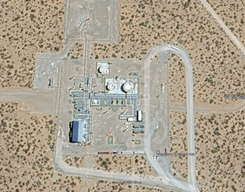
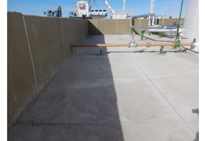

## **1 - INTRODUCCIÓN**

### Objetivo general

El objetivo general es evaluar daños y caracterizar la vulnerabilidad de
tanques de almacenamiento y otras estructuras laminares típicas de la
industria petrolera argentina bajo acciones de viento y fuego.

### Preguntas

El presente trabajo busca responder las siguientes preguntas:

1.  ¿Cómo pueden caracterizarse los tanques incluidos en la base de
    datos desde el punto de vista de dimensiones, tipos de techo,
    ubicación, fluido?

2.  ¿Es posible obtener alguna caracterización de los riesgos mas
    frecuentes?


## **2 - BASE DE DATOS**

Los datos sobre los tanques, objeto de análisis, se extrajeron de
informes realizados durante los años 2015 al 2022, los cuales se
encontraban clasificados según el tipo de auditoría realizada.

En algunos casos, las auditorías técnicas son de condición interna ó
externa, de control, de medición, de mantenimiento y en otros, se trata
de auditorías ambientales, de seguridad, de asentamiento, de abandono de
uso de tanques o de reparación, involucran variables ambientales, que
tratan, el entorno del tanque y/o la infraestructura existente en los
alrededores. El criterio de inclusión de los tanques en la base de datos
es que su volumen sea mayor o igual a 500m3, priorizando aquellos
tanques, que, por su escala operativa, representan un mayor riesgo
potencial y mayor probabilidad de daños.

A continuación, se explican los parámetros observados de las auditorias.

### Información Disponible

### Identificación

Variables: `id`, `oat`, `cit` y `taah`.

El número `cit` permite reconocer el tanque dentro del sistema de la
base de datos de la organización que realiza las auditorias. En este
caso, el número de `oat`, es la identificación interna para determinar
el origen de la información (número de informe/año de informe) y también
sirven a esta función las variables `id` y `taah`.

### Ubicación (Lat/Long)

Variables: `long`, `lat`.

La ubicación es importante a la hora de reconocer el tipo de clima al
que se encuentra expuesto el tanque, como lo es por ejemplo la velocidad
del viento a la que tiene que resistir. De la misma manera, el efecto
del sismo, el tipo de suelo, la intensidad de lluvia, etc. Estas
representan cargas externas, para lo cual la infraestructura debe estar
preparada para soportar y seguir en servicio.

### Estado

Variables: `estado`.

Esta variable, permite conocer la situación del tanque, ya que implica,
un escenario de carga y una condición de contorno diferente para la
estabilidad del tanque.

En operación, se puede considerar la condición de máxima presión
hidrostática, asumiendo para este estado como un tanque lleno. Como
señala Herrera (2007) en su documento, el líquido genera presiones que
ante un sismo, puede aumentar el riesgo de pandeo de pata de elefante en
la base, por superarse el límite crítico si el tanque es esbelto, H/D \>
0.7. En la condición de vacío, el tanque es mas liviano y mucho mas
vulnerable al viento. Por lo tanto, la relación de esbeltez también
incide en una posible falla de pandeo por presión externa, lo cual se
agrava, si el tanque no se encuentra rigidizado correctamente. La
condición de abandono, determina que el tanque se encuentra listo para
su reemplazo o que ha terminado su vida útil dentro de la planta o
batería a la que pertenece. Sin embargo, cuando estos activos están
presentes dentro de la infraestructura, existe un mayor riesgo de fallas
catastróficas, debido a el avance de la corrosión que pueden tener, o al
debilitamiento de sus componentes estructurales. Como consecuencia,
mayor riesgo de daños en tanques cercanos que se encuentren en
operación.

### Producto

Variables: `producto`.

Saber el producto que almacena un tanque es de gran importancia para
realizar un análisis preciso de riesgos. Esto incluye comprender sus
propiedades físicas y químicas, como la densidad, la volatilidad, la
inflamabilidad y la toxicidad. Estos datos son esenciales para evaluar y
mitigar posibles riesgos de seguridad, protección ambiental, y salud
publica asociados con el almacenamiento y manipulación del producto. Es
posible determinar el impacto que tiene la llama en función del tipo de
combustible que participe en algún evento de explosión o incendio que
involucre baterías de tanques, o plantas de refinerías. Por otro lado,
según el trabajo de Herrera (2007), se menciona que el daño depende de
las presiones hidrodinámicas, por lo tanto, el tipo de fluido define la
masaoscilante máxima posible. Un fluido más denso incrementará las
presiones de confinamiento y las fuerzas de inercia ante un sismo,
aumentando la probabilidad de llegar al estado de "pata de elefante"
incluso si el tanque no está al 100% de su capacidad. Los fluidos más
pesados, y densidades más altas, requieren mayor esfuerzo de corte en la
base y por lo tanto, mayor carga que podría desencadenar en mayor
probabilidad de asentamientos. Fluidos más livianos o refinados, aunque
tengan menor densidad, presentan tanques con mayor riesgo de incendio y
por otro lado, de volcamiento, si no se encuentran anclados.

### Prop. Físicas

Variables: `volumen`, `e_altura`, `e_diametro`.

Aspectos como el tamaño, la forma, el espesor de las paredes y la
ubicación de las soldaduras tienen un impacto directo en como se
distribuyen las cargas y las tensiones dentro del tanque.  Además de la
evaluación de la resistencia se evalúan las deformaciones que se
producen en función de la geometría del tanque frente a solicitaciones
externas, como se puede observar en "Daño sísmico de tanque de acero"
(Juan Carlos Herrera, 2007). En dicho trabajo, se plantean los daños que
se observaron en distintos eventos sísmicos y el análisis del parámetro
H/D como predictor de modos de falla. Tanques esbeltos H/D \> 0,7 son
tanques mucho más vulnerables a grandes esfuerzos de compresión en la
base, generando pandeo “pata de elefante” (Figura 6‑4).

{fig-align="center"}

*Figura 6‑4: Pandeo “pata de elefante” de la pared. Alaska-1964. (Juan
Carlos Herrera, 2007)*

Es fundamental aclarar que la relación entre la esbeltez y el volumen de
los tanques no es lineal. La probabilidad de que un tanque sufra un daño
severo (DS-4 o DS-5) aumenta considerablemente a medida que se
incrementa la relación H/D. Un tanque que es tanto de gran volumen como
esbelto enfrenta un riesgo estructural mucho mayor en comparación con
uno que tiene el mismo volumen pero un diámetro más amplio.

### Año de Montaje

Variables: `ano_montaje`.

Conocer el año de montaje permite determinar la edad del tanque y los
años en servicio. Una función importante de analizar, podría ser los
daños más frecuentes en base a los años en servicio. Como lo es, la
corrosión del metal ya que se trata de un proceso de degradación con el
paso del tiempo. Conocer si el tanque cumple o no con las regulaciones
vigentes, analizar la evolución de los estándares de diseño, realizar
análisis de seguridad ya que tanques más antiguos pueden tener más
problemas de corrosión o desgaste que podrían comprometer su integridad.
Por otro lado, la edad del tanque permite planificar el tipo de
mantenimiento necesario para garantizar la seguridad y el cumplimiento
normativo de las instalaciones petroleras. Por otro lado, tanques de
mayor edad, han pasado por más ciclos de llenado y vaciado, lo que suele
derivar en asentamientos diferenciales.

### Empresa

Variables: `empresa`.

Conocer la empresa puede dar información de la distribución de los
tanques según se trate de una operadora o algún tipo de planta, como una
refinería. En el caso de un tanque con mayor vulnerabilidad estructural,
y que se encuentre en una infraestructura densamente poblada, puede
provocar una falla o un colapso, ocasionando un desastre en cadena. El
tamaño y tipo de empresa, puede correlacionarse con el rigor de sus
programas de mantenimiento, parques más grandes de activos suelen tener
protocolos de inspección muy estrictos y presupuestos asignados para
reparaciones preventivas. A veces empresas más pequeñas o de servicios,
operan con márgenes de inversiones más ajustados.

### Virolas

Variables: `e_espesor1er_virola` y `e_virolas`.

ESPESOR PRIMER VIROLA

Como se mencionó en las propiedades físicas, el espesor influye en la
resistencia del tanque frente a la acción externa sobre su superficie. A
partir del espesor de la primera virola, se puede determinar el resto de
los espesores a través del “Método de un Pie” para tanques de diámetro
menores a 60m. Este valor es importante, debido a que la primer virola
es la que recibe mayor presión y relacionando esto con la edad del
tanque, es posible analizar la perdida de integridad del tanque. Por
otro lado, también es la que recibe mayor carga vertical y esto para
tanques esbeltos H/D \> 0.7, según Herrera (2007), produce mayor riesgo
de pandeo.

CANTIDAD DE VIROLAS

Conocer la cantidad de virolas, ayuda a comprender la capacidad de
almacenamiento, estabilidad estructural, además facilita la inspección y
el mantenimiento adecuado. Además, un tanque con bastantes virolas
cortas exhibe un comportamiento levemente diferente al de uno con
escasas virolas más altas ante fenómenos de abolladura.

### Resultado del informe

Variable: `resultado_informe`.

Esta información permite conocer las tareas a realizarse en el tanque,
en función del resultado de la auditoria. Así se puede extrapolar la
vida útil remanente del tanque, conocer los procesos de mantenimiento
y/o reparación aplicados, conocer la eficiencia operativa y la
fiabilidad de las instalaciones de almacenamiento de productos
almacenados.

### Diques de Contención

Variables: `dc_individual`, `dc_compartido` y `dc_dimensiones`.

Los diques de contención son parte de la infraestructura de los tanques
y forman parte de un requisito obligatorio. Desde un punto de vista
ambiental interesa conocer el estado de dicha contención o su existencia
frente a la posibilidad de derrames, y/o protección de la
infraestructura circundante. Por otro lado, frente a la acción del
viento, es posible estudiar el efecto que tienen estas estructuras en
como pantallas frente a la superficie de un tanque.

|  |  |
|------------------------------------|------------------------------------|
| {width="271"} | {width="312"} |

*Figura 6‑6a: A la izquierda, lay out en imagen satelital. A la derecha,
imagen de interior del recinto de contención*

### Tipo de Techo

Variable: `tipo_de_techo`.

El tipo de techo puede afectar la seguridad operativa del tanque, los
techos flotantes son más propensos a problemas como la acumulación de
gases inflamables debajo del techo. Algunos tipos de techos son más
adecuados para ciertos tipos de productos petrolíferos ligeros, mientras
que los techos fijos pueden ser más adecuados para productos más pesados
o viscosos. Por otro lado, el tipo de techo puede influir en los
requisitos de mantenimiento y reparación del tanque. Los techos
flotantes pueden requerir inspecciones más frecuentes y mantenimiento
especializado. El tipo de techo influye en el comportamiento estructural
del tanque frente a acciones térmicas, ya que estas generan muchas
deformaciones. También frente a la acción del viento sobre la corona del
tanque, y por otro lado, en tanques bajos (H/D \< 0.7), según las curvas
de fragilidad del documento "Daño sísmico de tanque de acero" (Juan
Carlos Herrera, 2007), se demostró que son más propensos a problemas de
*sloshing* (oleaje) afectando la estructura del techo.

### Corrosión y Asentamientos

Variables: `medicion_de_corrosion` y `medicion_de_asent_dif`.

La corrosión puede comprometer la integridad estructural del tanque, por
ello, conocer la existencia de estas mediciones puede colaborar en el
desarrollo de medidas preventivas y correctivas, teniendo en cuenta las
consecuencias y el estado operativo del tanque.

Los asentamientos pueden indicar problemas de la base del tanque, como
la compactación del suelo o falta de capacidad de carga. Conocer la
magnitud y la naturaleza de los asentamientos es esencial para evaluar
la integridad estructural del tanque ya que se puede comprometer la
estabilidad del tanque y aumentar riesgo de falla estructural, incluido
vuelco o deformaciones excesivas. Además, los asentamientos
diferenciales pueden causar tensiones no deseadas en las soldaduras y
juntas del tanque, lo que aumenta el riesgo de fugas y derrames.

### Comentarios y Adjuntos

Variables: `archivo_doc`, `adjuntos`.

En este ítem se pretende resaltar información que pueda ser de utilidad,
o aporte mayor claridad del contexto para la interpretación de la base
de datos, de manera visual o descriptiva. En algunos casos se adjuntan
imágenes, croquis de ubicación y de geometrías.

## **3 - EDA**

ANALISIS EXPLORATORIO DE DATOS

### Lectura de los datos

Se comienza importando los datos y cargando las librerías a utilizar en
el informe. Se utilizará como marco de referencia el entorno de
tidyverse.

```{r message=FALSE, warning=FALSE, ECHO=FALSE, results='hide'}
#| include: false
library(tidyverse)
library(readxl)
library(janitor)
library(skimr)
library(naniar)
library(lubridate)

# Librerias estetica
library(knitr) # Tablas
library(kableExtra) # Tablas

# Se eliminan variables previas en la sesión
rm(list=ls())

# Lectura del xml
tanques <- read_excel("Datos/Datos_Tanques.xlsx") %>%
  clean_names()

```

### Inspección visual

Se realiza una inspección visual inicial de los datos para observar
tipos de variables y datos faltantes.

```{r}
#| echo: false
#| message: false
#| warning: false

tanques |> head(3) |> 
  kable(
    booktabs = TRUE,
  ) |>
  kable_styling(position = "center")

```

Son 263 individuos (tanques) a los que se les observaron 27 variables. A
priori se estima que hay muchos valores faltantes. Desde el punto de
vista de ingeniería, el volumen de los tanques es una de las variables
más representativas para visualizar las dimensiones estructurales por lo
que proponemos un histograma como acercamiento inicial al tema:

```{r}
#| echo: false
#| message: false
#| warning: false
library(tidyverse)

ggplot(tanques, aes(x = volumen)) +
  geom_histogram(
    bins = 30,
    fill = "steelblue",
    color = "black",
    alpha = 0.8
  ) +
  geom_vline(
    aes(xintercept = median(volumen, na.rm = TRUE)),
    color = "red",
    linewidth = 1
  ) +
  labs(
    title = "Distribución de los volúmenes de almacenamiento",
    subtitle = "Tanques auditados entre 2015 y 2022",
    x = "Volumen [m³]",
    y = "Cantidad de tanques"
  ) +
  theme_minimal()
```

La distribución presenta una fuerte asimetría positiva, concentrándose
la mayoría de los tanques en capacidades bajas y medias. Los tanques de
gran volumen constituyen una proporción reducida de la muestra, aunque
poseen mayor relevancia desde el punto de vista de las consecuencias
potenciales ante una falla estructural.

La mediana indicada con la línea vertical roja es igual a 2000 metros
cúbicos.

Luego, cada registro representa un informe técnico, por lo que
visualizamos los resultados que se obtuvieron:

```{r}
#| echo: false
#| message: false
#| warning: false
tanques %>%
  count(resultado_informe) %>%
  mutate(
    porcentaje = round(100*n/sum(n),1)
  ) %>%
  ggplot(aes(
    x = reorder(resultado_informe,n),
    y = porcentaje,
    fill = resultado_informe
  )) +
  geom_col(show.legend = FALSE) +
  coord_flip() +
  geom_text(aes(label = paste0(porcentaje,"%")),
            hjust = -0.1) +
  labs(
    title = "Distribución porcentual del resultado de auditoría",
    x = "",
    y = "% de tanques"
  ) +
  theme_minimal()
```

Es de notar que solo el 53% de los tanques relevados se clasificaron
como aptos, lo que da un primer indicador del estado general de la
infraestructura relevada, poniendo en contexto que se trata de
estructuras críticas cuya falla puede tener consecuencias ambientales,
economicas y sociales severas.

Además puede ser una variable de interés para aplicar métodos de
clasificación en función de otras variables.

Previo a profundizar en otras caracterizaciones procedemos con la
limpieza y ordenamiento de datos.

### Valores faltantes (var)

En la inspección visual se observa una gran cantidad de datos faltantes
distribuidos en todas las **variables**, por lo que se procede a
identificar la cantidad de valores faltantes.

```{r}
#| echo: false
#| message: false
#| warning: false
# Variables con la mayor cantidad de datos faltantes
tanques |> 
  summarise(across(everything(),
                   ~ sum(is.na(.)))) |> 
  pivot_longer(everything(),
               names_to = "variable",
               values_to = "faltantes")  |> 
  arrange(desc(faltantes)) |> 
  head(6)

# Cantidad total de valores faltantes
# tanques |> summarise(across(everything(), ~ sum(is.na(.)))) |> sum()
```

Se observa que la variable `dc_compartido` (que indica si se compartió
información sobre los diques de contención) es la que mayor cantidad de
datos faltantes posee, luego `comentarios` (comentarios del inspector
sobre el informe de auditoría) y en tercer lugar `dc_dimensiones`.
También entra en el top 6 la variable `dc_individual`.

Como los diques de contención son construcciones con el objetivo de
salvaguardar el medioambiente y no forman parte de las propiedades
físicas del tanque, y dado que es el punto donde más datos faltantes se
observan (344 *NA* entre las 3), no se utilizará información sobre los
diques de contención en el análisis.

```{r}
#| include: false
# se eliminan las variables a no utilizar luego del analisis de datos faltantes
tanques <- tanques |> select(!(c(dc_compartido, 
                                 comentarios,
                                 dc_dimensiones,
                                 dc_individual)))

```

### **Valores faltantes (reg)**

Y también se deben revisar los **registros** para no mantener aquellos
que tengan una gran cantidad de datos faltantes. Como criterio se
considera que los informes deben tener más datos registrados que
ausentes, por lo que al ser 23 variables, se considera que registros con
12 o más NA serán eliminados.

```{r}
#| echo: false
#| message: false
#| warning: false
# Se observan los registros con mayor cantidad de datos faltantes

tanques |> 
  mutate(num_na = rowSums(is.na(across(everything())))) |> 
  select(id, num_na) |>
  arrange(desc(num_na)) |> 
  head(6)
```

Por lo tanto, se eliminan 4 registros (id 180, 409, 410 y 311).

```{r}
#| include: false
# Se eliminan 4 registros con +50% de NA
tanques <- tanques |> 
  filter(!id %in% c(180, 409, 410, 311))

```

### Tipo de datos

Se revisa que las variables esten almacenadas con el tipo de dato que
corresponde.

```{r}
#| include: false

tipos_datos <- tibble(
  variable = names(tanques),
  tipo = sapply(tanques, class)
)

tipos_datos
```

Todas las variables se clasificaron en *numeric* o *character*.

Las variables *cuantitativas* están correctamente almacenadas como
*numeric* y no hace falta convertirlas.

```{r}
#| echo: false
#| message: false
#| warning: false
tipos_datos |> filter(tipo == "numeric") |> 
  kable() |>
  kable_styling(position = "center")
```

Pero si bien `id` es un número, será utilizado como etiqueta, por lo que
la convertiremos a *character.*

```{r}
#| include: false
# Se convierte id a factor
tanques <- tanques |> 
  mutate(id = as_factor(id))


# Se actualizan los tipos de datos
tipos_datos <- tibble(
  variable = names(tanques),
  tipo = sapply(tanques, class)
)
```

Vemos las *cualitativas*:

```{r}
#| echo: false
#| message: false
#| warning: false
tipos_datos |> filter(tipo == "character") |> 
  kable() |>
  kable_styling(position = "center")
```

Descartamos las siguientes variables del análisis:

- `oat`, `cit` y `taah` porque son etiquetas identificatorias y
  utilizaremos `id` como identificador del tanque.

- `ubicacion` debido a que su información ya se encuentra con precisión
  en las variables `long` y `lat`.

- `archivo_doc`, `adjuntos` y `tipoinforme` por el hecho de que este
  estudio se centra unicamente en las propiedades físicas de los tanques
  y estas variables no aportan información utilizable.

```{r}
#| include: false
# se eliminan las variables cualitativas a no utilizar
tanques <- tanques |> select(!(c(oat,
                                 cit,
                                 taah,
                                 ubicacion,
                                 archivo_doc,
                                 adjuntos,
                                 tipoinforme)))
```

Asignamos a los NA en variables categóricas el estado "DESCONOCIDO".

```{r}
#| include: false
#Estados desconocidos
tanques <- tanques %>%
  mutate(
    estado = replace_na(estado, "DESCONOCIDO"),
    producto = replace_na(producto, "DESCONOCIDO"),
    empresa = replace_na(empresa, "DESCONOCIDO"),
    tipo_de_techo = replace_na(tipo_de_techo , "DESCONOCIDO"),
    resultado_informe = replace_na(resultado_informe, "DESCONOCIDO"),
    medicion_de_corrosion = replace_na(resultado_informe, "DESCONOCIDO"),
    medicion_de_asent_dif = replace_na(medicion_de_asent_dif, "DESCONOCIDO")
  )
```

La variable `tipo_de_techo` no es muy explicativa con el nombre de sus
categorías. Por ejemplo, utiliza "F" para indicar "tipo de techo Fijo"
que puede confundirse con "Flotante".

```{r}
#| include: false
# Se convierte a factor y se observan los datos
tanques |> 
  mutate(tipo_de_techo = factor(tipo_de_techo)) |> 
  select(tipo_de_techo) |> 
  summary()
```

Cambiamos esas categorías para evitar confusiones.

```{r}
#| include: false
# Se realizan las modificaciones
tanques <- tanques |> 
  mutate(tipo_de_techo = case_when(
    tipo_de_techo == "F" ~ "FIJO",
    tipo_de_techo == "FLOT" ~ "FLOTANTE",
    TRUE ~ tipo_de_techo   # mantiene el resto igual
  )) |> 
  mutate(tipo_de_techo = factor(tipo_de_techo))

# Se observa que los niveles hayan quedado bien
tanques |> 
  select(tipo_de_techo) |> 
  summary()
```

Convertimos las variables `estado` y `resultado_informe` a categóricas
para facilitar su tratamiento.

```{r}
#| include: false
# variables tipo character a factores
tanques <- tanques |> 
  mutate(
    estado = as.factor(estado),
    resultado_informe = as.factor(resultado_informe),
    medicion_de_asent_dif = as.factor(medicion_de_asent_dif),
    medicion_de_corrosion = as.factor(medicion_de_corrosion)
  )

```

### Productos almacenados

Se debe corregir la variable `producto` ya que por falta de criterios de
estandarización en la toma de datos tiene muchos valores diferentes para
indicar lo mismo, por ejemplo, se observa "AGUA + PETROLEO" y también
"PETROLEO + AGUA" o "AGUA CON PETROLEO", etc.

Visualizando los valores que toma la variable identificamos que algunas
categorias presentan muchas observaciones, como por ejemplo:

- AGUA

- PETROLEO

- PETROLEO + AGUA

- GAS OIL, etc

Por lo que a ellas las dejamos y solo estandarizamos el nombre.

Luego vemos que hay mucha diversidad de productos. En vez de agruparlos
a todos juntos en una categoría "OTROS", los agrupamos por su densidad
ya que esta propiedad es muy importante para entender las cargas del
producto sobre las paredes de los tanques. Las categorías son:

- LIVIANOS (\~0.65–0.75 g/cm³)

- INTERMEDIOS (\~0.78–0.83 g/cm³)

- PESADOS (\~0.83–0.95 g/cm³)

A los restantes los agrupamos en OTROS por no tener información sobre
ellos o por no poseer más de una o dos observaciones.

```{r}
#| eval: false
#| message: false
#| warning: false
#| include: false

# ******************************************************************
#
#   NO SE EJECUTA
#
# Se deja este código oculto por si en el futuro se quiere profundizar
# en un análisis con mayor detalle de clasificación de productos. Para el
# trabajo actual se considera suficiente una agrupación más general (ver debajo)
# ******************************************************************


# Hay 145 valores unicos en la variable producto
unique(tanques$producto)

# Hay que hacer una tabla de equivalencias para estandarizar nombres y agrupar
dicc <- c(
  "Agua" = "AGUA",
  "AGUA DULCE" = "AGUA",
  "Agua de Inyección"   = "AGUA",
  "Agua de formación" = "AGUA",
  "Agua de formacion" = "AGUA",
  "Agua de Formacion" = "AGUA",
  "Agua de Formación" = "AGUA",
  "AGUA DE FORMACIÓN" = "AGUA",
  "AGUA DE FORMACION" = "AGUA",
  "AGUA Y CONDENSADOS" = "AGUA",
  "Agua de producción" = "AGUA",
  "AGUA HIDROCARBURADA" = "AGUA",
  "Agua hidrocarburada" = "AGUA",
  "Agua Hidrocarburada" = "AGUA",
  "Agua Hidrocarburada." = "AGUA",
  "AGUA CON HIDROCARBURO" = "AGUA",
  "Almacenado: Agua de producción" = "AGUA",
  "AGUA TRATADA" = "AGUA",
  "Aguas Agrias" = "AGUA",
  
  "PETROLEO TRATADO" = "PETROLEO",
  "Petroleo" = "PETROLEO",
  "Petróleo" = "PETROLEO",
  "Pétroleo" = "PETROLEO",
  "PETRÓLEO" = "PETROLEO",
  "PETROLEO\r\r\nPETRÓLEO" = "PETROLEO",
  "Crudo en especificación" = "PETROLEO",
  "CRUDO EN PROCESO" = "PETROLEO",
  "CRUDO" = "PETROLEO",
  "Crudo" = "PETROLEO",
  "CRUDO DE PETROLEO" = "PETROLEO",
  "PETROLEO CRUDO" = "PETROLEO",
  "PETRÓLEO CRUDO" = "PETROLEO",
  "Petróleo crudo" = "PETROLEO",
  "Almacenamiento de Crudo en especificación"= "PETROLEO",
  
  "PETRÓLEO/AGUA" = "PETROLEO + AGUA",
  "PETROLEO/AGUA" = "PETROLEO + AGUA",
  "Petroleo/Agua" = "PETROLEO + AGUA",
  "Petróleo + Agua" = "PETROLEO + AGUA",
  "Petroleo + Agua" = "PETROLEO + AGUA",
  "AGUA Y PETROLEO" = "PETROLEO + AGUA",
  "AGUA Y PETRÓLEO" = "PETROLEO + AGUA",
  "Agua + Petroleo" = "PETROLEO + AGUA",
  "Agua + Petróleo" = "PETROLEO + AGUA",
  "AGUA + PETROLEO" = "PETROLEO + AGUA",
  "AGUA + PETRÓLEO" = "PETROLEO + AGUA",
  "HIDROCARBURO Y AGUA DE FORMACION" = "PETROLEO + AGUA",
  "Agua/crudo" = "PETROLEO + AGUA",
  "Agua/Petroleo" = "PETROLEO + AGUA",
  "PETROLEO y AGUA" = "PETROLEO + AGUA",
  "Petróleo Hidratado" = "PETROLEO + AGUA",
  "petróleo y agua" = "PETROLEO + AGUA",
  "Petróleo y agua" = "PETROLEO + AGUA",
  "PETROLEO Y AGUA" = "PETROLEO + AGUA",
  "PETROLEO / AGUA FORMACION" = "PETROLEO + AGUA",
  "PETROLEO CON AGUA" = "PETROLEO + AGUA",
  "CRUDO HIDRATADO" = "PETROLEO + AGUA",
  "Crudo Hidratado" = "PETROLEO + AGUA",
  "PETROLEO HIDRATADO" = "PETROLEO + AGUA",
  "Petróleo / Agua" = "PETROLEO + AGUA",
  "AGUA CON PETRÓLEO" = "PETROLEO + AGUA",
  "AGUA-PETROLEO" = "PETROLEO + AGUA",
  "AGUA+PETROLEO" = "PETROLEO + AGUA",
  "AGUA E HIDROCARBUROS" = "PETROLEO + AGUA",
  "Agua e Hidrocarburo" = "PETROLEO + AGUA",
  "Petróleo y agua)" = "PETROLEO + AGUA",
  "Agua y crudo en especificación" = "PETROLEO + AGUA",
  "PETROLEO AGUA" = "PETROLEO + AGUA",
  "Agua de producción y crudo" = "PETROLEO + AGUA",
  "PETROLEO-AGUA" = "PETROLEO + AGUA",
  "PETR+AGUA" = "PETROLEO + AGUA",
  "PETROLEO + AGUA." = "PETROLEO + AGUA",
  "PETROLEO+AGUA" = "PETROLEO + AGUA",
  "Agua + Petróleo." = "PETROLEO + AGUA",
  
  "GASOLINA"  = "GAS OIL",
  "BIODIESEL"  = "GAS OIL",
  "DIESEL MARINO"  = "GAS OIL",
  "Gas oil"  = "GAS OIL",
  "Gas Oil"  = "GAS OIL",
  "GAS OIL"  = "GAS OIL",
  "Gasoil"  = "GAS OIL",
  "Infinia Diesel"  = "GAS OIL",
  "Gasolina Estabilizada."  = "GAS OIL",
  "FUEL OIL"  = "GAS OIL",
  "Fuel Oil"  = "GAS OIL",
  "Fuel oil"  = "GAS OIL",
  "GAS OIL Liviano de Cracking Catalítico"  = "GAS OIL",
  "Intermedio Gas Oil"  = "GAS OIL",
  
  "Nafta"  = "NAFTA",
  "Nafta Hidrotratada Liviana" = "NAFTA",
  "NAFTA VIRGEN"  = "NAFTA",
  "Nafta Virgen"  = "NAFTA",
  "Nafta Super"  = "NAFTA",
  "Nafta Súper"  = "NAFTA",
  "NAFTA ULTRA"  = "NAFTA",
  "Nafta Catalítica"  = "NAFTA",
  "NAFTAS"  = "NAFTA",
  "NAFTA LIGERA CREQUEADA"  = "NAFTA",
  "NAFTA COMÚN"  = "NAFTA",
  "NAFTA LIVIANA" = "NAFTA",
  
  "Parafina" = "PARAFINA",
  "Solvente Parafínico Hidrogenado" = "PARAFINA",
  "PARAFINA HIDROGENADA" = "PARAFINA",
  "N-PARAFINA" = "PARAFINA",
  
  "Base Lubricante" = "BASE LUBRICANTES",
  "Base lubricante" = "BASE LUBRICANTES", 
  "Corte Lubricante" = "BASE LUBRICANTES",
  "BASE LUBRICANTE" = "BASE LUBRICANTES",
  
  "ISOHEXANO" = "LIVIANOS",
  "MTBE" = "LIVIANOS",
  "BENCENO" = "LIVIANOS",
  "ESTIRENO" = "LIVIANOS",
  "Metanol" = "LIVIANOS",
  "METANOL" = "LIVIANOS",
  "Aguarrás" = "LIVIANOS",
  "Alkilado" = "LIVIANOS",
  
  "INTERMEDIO" = "INTERMEDIOS",
  "JP1" = "INTERMEDIOS",
  "Kerosene" = "INTERMEDIOS",
  "CONDENSADO" = "INTERMEDIOS",
  "REFORMADO" = "INTERMEDIOS",
  "Reformado Liviano" = "INTERMEDIOS",
  "CORTE AROMATICO LIVIANO" = "INTERMEDIOS",
  "CORTE AROMATICO LIVIANO\r\r\nAROMÁTICO\r\r\nCORTE AROMATICO LIVIANO" = "INTERMEDIOS",
  
  "Extracto Aromático" = "PESADOS",
  "EXTRACTO" = "PESADOS",
  "EXTENSOR" = "PESADOS",
  "Destilado Corte 20" = "PESADOS",
  "Slop de Coque" = "PESADOS",
  "SLOP" = "PESADOS",
  "Slop" = "PESADOS",
  "Slurry" = "PESADOS",
  "LFO 380" = "PESADOS",
  "BISOLVENTE" = "PESADOS",
  
  "EN TRAMITE" = "OTROS",
  "LAB FINAL." = "OTROS",
  "Corte 20364" = "OTROS",
  "Componente petroquímico." = "OTROS",
  "DRIPOLENE" = "OTROS",
  "Refinado" = "OTROS",
  "REFINADO" = "OTROS",
  "Otros (aclarar cuál)\r\r\nSi selecciona Otro aclarar :\r\r\nINTERMEDIOS" = "OTROS"
  )

tanques <- tanques |> 
  mutate(
    # Reemplaza usando el diccionario original; si el valor no está en el diccionario, conserva el valor original
    producto = coalesce(dicc[producto], producto),
    producto = na_if(producto, "NA"),
    producto = as.factor(producto)
  )


```

Criterio simplificado, se distingue entre agua, petróleo crudo y
derivados de petróleo.

```{r}
#| include: false
# Se plantea un reducción de tipos de productos más generalista

# Hay 145 valores unicos en la variable producto
unique(tanques$producto)

# Hay que hacer una tabla de equivalencias para estandarizar nombres y agrupar
dicc <- c(
  "Agua" = "AGUA",
  "AGUA DULCE" = "AGUA",
  "Agua de Inyección"   = "AGUA",
  "Agua de formación" = "AGUA",
  "Agua de formacion" = "AGUA",
  "Agua de Formacion" = "AGUA",
  "Agua de Formación" = "AGUA",
  "AGUA DE FORMACIÓN" = "AGUA",
  "AGUA DE FORMACION" = "AGUA",
  "AGUA Y CONDENSADOS" = "AGUA",
  "Agua de producción" = "AGUA",
  "AGUA HIDROCARBURADA" = "AGUA",
  "Agua hidrocarburada" = "AGUA",
  "Agua Hidrocarburada" = "AGUA",
  "Agua Hidrocarburada." = "AGUA",
  "AGUA CON HIDROCARBURO" = "AGUA",
  "Almacenado: Agua de producción" = "AGUA",
  "AGUA TRATADA" = "AGUA",
  "Aguas Agrias" = "AGUA",
  
  "PETROLEO TRATADO" = "PETROLEO",
  "Petroleo" = "PETROLEO",
  "Petróleo" = "PETROLEO",
  "Pétroleo" = "PETROLEO",
  "PETRÓLEO" = "PETROLEO",
  "PETROLEO\r\r\nPETRÓLEO" = "PETROLEO",
  "Crudo en especificación" = "PETROLEO",
  "CRUDO EN PROCESO" = "PETROLEO",
  "CRUDO" = "PETROLEO",
  "Crudo" = "PETROLEO",
  "CRUDO DE PETROLEO" = "PETROLEO",
  "PETROLEO CRUDO" = "PETROLEO",
  "PETRÓLEO CRUDO" = "PETROLEO",
  "Petróleo crudo" = "PETROLEO",
  "Almacenamiento de Crudo en especificación"= "PETROLEO",
  
  "PETRÓLEO/AGUA" = "PETROLEO + AGUA",
  "PETROLEO/AGUA" = "PETROLEO + AGUA",
  "Petroleo/Agua" = "PETROLEO + AGUA",
  "Petróleo + Agua" = "PETROLEO + AGUA",
  "Petroleo + Agua" = "PETROLEO + AGUA",
  "AGUA Y PETROLEO" = "PETROLEO + AGUA",
  "AGUA Y PETRÓLEO" = "PETROLEO + AGUA",
  "Agua + Petroleo" = "PETROLEO + AGUA",
  "Agua + Petróleo" = "PETROLEO + AGUA",
  "AGUA + PETROLEO" = "PETROLEO + AGUA",
  "AGUA + PETRÓLEO" = "PETROLEO + AGUA",
  "HIDROCARBURO Y AGUA DE FORMACION" = "PETROLEO + AGUA",
  "Agua/crudo" = "PETROLEO + AGUA",
  "Agua/Petroleo" = "PETROLEO + AGUA",
  "PETROLEO y AGUA" = "PETROLEO + AGUA",
  "Petróleo Hidratado" = "PETROLEO + AGUA",
  "petróleo y agua" = "PETROLEO + AGUA",
  "Petróleo y agua" = "PETROLEO + AGUA",
  "PETROLEO Y AGUA" = "PETROLEO + AGUA",
  "PETROLEO / AGUA FORMACION" = "PETROLEO + AGUA",
  "PETROLEO CON AGUA" = "PETROLEO + AGUA",
  "CRUDO HIDRATADO" = "PETROLEO + AGUA",
  "Crudo Hidratado" = "PETROLEO + AGUA",
  "PETROLEO HIDRATADO" = "PETROLEO + AGUA",
  "Petróleo / Agua" = "PETROLEO + AGUA",
  "AGUA CON PETRÓLEO" = "PETROLEO + AGUA",
  "AGUA-PETROLEO" = "PETROLEO + AGUA",
  "AGUA+PETROLEO" = "PETROLEO + AGUA",
  "AGUA E HIDROCARBUROS" = "PETROLEO + AGUA",
  "Agua e Hidrocarburo" = "PETROLEO + AGUA",
  "Petróleo y agua)" = "PETROLEO + AGUA",
  "Agua y crudo en especificación" = "PETROLEO + AGUA",
  "PETROLEO AGUA" = "PETROLEO + AGUA",
  "Agua de producción y crudo" = "PETROLEO + AGUA",
  "PETROLEO-AGUA" = "PETROLEO + AGUA",
  "PETR+AGUA" = "PETROLEO + AGUA",
  "PETROLEO + AGUA." = "PETROLEO + AGUA",
  "PETROLEO+AGUA" = "PETROLEO + AGUA",
  "Agua + Petróleo." = "PETROLEO + AGUA",
  
  "GASOLINA"  = "DERIVADOS DE PETROLEO",
  "BIODIESEL"  = "DERIVADOS DE PETROLEO",
  "DIESEL MARINO"  = "DERIVADOS DE PETROLEO",
  "Gas oil"  = "DERIVADOS DE PETROLEO",
  "Gas Oil"  = "DERIVADOS DE PETROLEO",
  "GAS OIL"  = "DERIVADOS DE PETROLEO",
  "Gasoil"  = "DERIVADOS DE PETROLEO",
  "Infinia Diesel"  = "DERIVADOS DE PETROLEO",
  "Gasolina Estabilizada."  = "DERIVADOS DE PETROLEO",
  "FUEL OIL"  = "DERIVADOS DE PETROLEO",
  "Fuel Oil"  = "DERIVADOS DE PETROLEO",
  "Fuel oil"  = "DERIVADOS DE PETROLEO",
  "GAS OIL Liviano de Cracking Catalítico"  = "DERIVADOS DE PETROLEO",
  "Intermedio Gas Oil"  = "DERIVADOS DE PETROLEO",
  
  "Nafta"  = "DERIVADOS DE PETROLEO",
  "Nafta Hidrotratada Liviana" = "DERIVADOS DE PETROLEO",
  "NAFTA VIRGEN"  = "DERIVADOS DE PETROLEO",
  "Nafta Virgen"  = "DERIVADOS DE PETROLEO",
  "Nafta Super"  = "DERIVADOS DE PETROLEO",
  "Nafta Súper"  = "DERIVADOS DE PETROLEO",
  "NAFTA ULTRA"  = "DERIVADOS DE PETROLEO",
  "Nafta Catalítica"  = "DERIVADOS DE PETROLEO",
  "NAFTAS"  = "DERIVADOS DE PETROLEO",
  "NAFTA LIGERA CREQUEADA"  = "DERIVADOS DE PETROLEO",
  "NAFTA COMÚN"  = "DERIVADOS DE PETROLEO",
  "NAFTA LIVIANA" = "DERIVADOS DE PETROLEO",
  "NAFTA" = "DERIVADOS DE PETROLEO",
  
  "Parafina" = "DERIVADOS DE PETROLEO",
  "PARAFINA" = "DERIVADOS DE PETROLEO",
  "Solvente Parafínico Hidrogenado" = "DERIVADOS DE PETROLEO",
  "PARAFINA HIDROGENADA" = "DERIVADOS DE PETROLEO",
  "N-PARAFINA" = "DERIVADOS DE PETROLEO",
  
  "Base Lubricante" = "DERIVADOS DE PETROLEO",
  "Base lubricante" = "DERIVADOS DE PETROLEO", 
  "Corte Lubricante" = "DERIVADOS DE PETROLEO",
  "BASE LUBRICANTE" = "DERIVADOS DE PETROLEO",
  "BASE LUBRICANTES" = "DERIVADOS DE PETROLEO",
  
  "ISOHEXANO" = "DERIVADOS DE PETROLEO",
  "MTBE" = "DERIVADOS DE PETROLEO",
  "BENCENO" = "DERIVADOS DE PETROLEO",
  "ESTIRENO" = "DERIVADOS DE PETROLEO",
  "Metanol" = "DERIVADOS DE PETROLEO",
  "METANOL" = "DERIVADOS DE PETROLEO",
  "Aguarrás" = "DERIVADOS DE PETROLEO",
  "Alkilado" = "DERIVADOS DE PETROLEO",
  
  "INTERMEDIO" = "DERIVADOS DE PETROLEO",
  "INTERMEDIOs" = "DERIVADOS DE PETROLEO",
  "JP1" = "DERIVADOS DE PETROLEO",
  "Kerosene" = "DERIVADOS DE PETROLEO",
  "CONDENSADO" = "DERIVADOS DE PETROLEO",
  "REFORMADO" = "DERIVADOS DE PETROLEO",
  "Reformado Liviano" = "DERIVADOS DE PETROLEO",
  "CORTE AROMATICO LIVIANO" = "DERIVADOS DE PETROLEO",
  "CORTE AROMATICO LIVIANO\r\r\nAROMÁTICO\r\r\nCORTE AROMATICO LIVIANO" = "DERIVADOS DE PETROLEO",
  
  "Extracto Aromático" = "DERIVADOS DE PETROLEO",
  "EXTRACTO" = "DERIVADOS DE PETROLEO",
  "EXTENSOR" = "DERIVADOS DE PETROLEO",
  "Destilado Corte 20" = "DERIVADOS DE PETROLEO",
  "Slop de Coque" = "DERIVADOS DE PETROLEO",
  "SLOP" = "DERIVADOS DE PETROLEO",
  "Slop" = "DERIVADOS DE PETROLEO",
  "Slurry" = "DERIVADOS DE PETROLEO",
  "LFO 380" = "DERIVADOS DE PETROLEO",
  "BISOLVENTE" = "DERIVADOS DE PETROLEO",
  "INTERMEDIOS" = "DERIVADOS DE PETROLEO",
  
  "EN TRAMITE" = "OTROS",
  "LAB FINAL." = "OTROS",
  "Corte 20364" = "OTROS",
  "Componente petroquímico." = "OTROS",
  "DRIPOLENE" = "OTROS",
  "Refinado" = "OTROS",
  "REFINADO" = "OTROS",
  "Otros (aclarar cuál)\r\r\nSi selecciona Otro aclarar :\r\r\nINTERMEDIOS" = "OTROS"
)

tanques <- tanques |> 
  mutate(
    # Reemplaza usando el diccionario original; si el valor no está en el diccionario, conserva el valor original
    producto = coalesce(dicc[producto], producto),
    producto = na_if(producto, "NA"),
    producto = as.factor(producto)
  )
```

```         
```

Los productos más representados corresponden a petróleo, mezclas de
petróleo y agua, agua de formación y combustibles derivados. Esta
diversidad implica distintos escenarios de riesgo asociados tanto a las
cargas estructurales como a la peligrosidad frente a incendios o
derrames.

```{r}
#| echo: false
#| message: false
#| warning: false
tanques %>%
  count(producto) %>%
  mutate(
    porcentaje = round(100*n/sum(n),1)
  ) %>%
  ggplot(aes(
    x = reorder(producto,n),
    y = porcentaje,
    fill = producto
  )) +
  geom_col(show.legend = FALSE) +
  coord_flip() +
  geom_text(aes(label = paste0(porcentaje,"%")),
            hjust = -0.1) +
  labs(
    title = "Distribución porcentual de Productos almacenados",
    x = "",
    y = "% del producto"
  ) +
  theme_minimal()
```

### Principales empresas

También se debe corregir la variable `empresa` ya que por falta de
criterios de estandarización en la toma de datos tiene muchos valores
diferentes para indicar lo mismo, por ejemplo, se observa "YPF S.A."
pero también "Y.P.F S.A".

```{r results='hide'}
#| message: false
#| warning: false
#| include: false
# Hay 69 valores unicos en la variable empresa
sort(unique(tanques$empresa))

# Al ver los nombres de las empresas ordenadas alfabeticamente se destaca que todas difieren en las 3 primeras letras por lo que se estandaríza en esa cantidad, salvo "Central Process Facility Bandurria centro" por lo que se transforma previamente.

tanques <- tanques |> 
  # se reemplaza la que se puede confundir
  mutate(
    empresa = ifelse(empresa == "Central Process Facility Bandurria centro", "CPF",empresa)
  ) |> 
  # se procesa masivamente todos los valores
  mutate(
    empresa = empresa |> 
      str_to_lower() |>                           # 1) pasar a minúsculas
      str_replace_all("[[:space:].]", "") |>      # 2) eliminar espacios y puntos
      str_sub(1, 3)                               # 3) tomar las primeras letras 
  ) 

# Se obtuvieron 21 valores diferentes. 
unique(tanques$empresa)

# Para simplificar la lectura se reemplazan las 3 letras por el nombre de la empresa
dicc <- c("ter" = "T GB",
          "fsa" = "F SA",
          "ypf" = "YPF",
          "plu" = "PLUSPETROL",
          "vis" = "VISTA",
          "vil" = "VILUCO",
          "geo" = "GEOPARK",
          "tra" = "TGS",
          "cen" = "CENTRALES DCA",
          "cil" = "CILP",
          "pet" = "PETROBRAS",
          "ena" = "ENAP",
          "ope" = "PELSA",
          "pan" = "PAN AMERICAN",
          "oil" = "OILSTONE",
          "tec" = "TECPETROL",
          "ref" = "REFINORTE",
          "exx" = "EXXON",
          "cap" = "CAPEX",
          "old" = "OLDELVAL",
          "cpf" = "CPF BC")

tanques <- tanques |> 
  mutate(
    # Reemplaza usando el diccionario original; si el valor no está en el diccionario, conserva el valor original
    empresa = coalesce(dicc[empresa], empresa),
    empresa = na_if(empresa, "NA"),
    empresa = as.factor(empresa)
  )
```

Finalmente podemos ver el ranking de cantidad de tanques por empresa:

```{r}
#| echo: false
#| message: false
#| warning: false

# El ranking de tanques por empresa
tanques |> count(empresa, sort = TRUE)

```

Y su distribución porcentual.

```{r}
#| echo: false
#| message: false
#| warning: false
tanques %>%
  count(empresa) %>%
  mutate(
    porcentaje = round(100*n/sum(n),1)
  ) %>%
  slice_max(order_by=n,n=10)%>%
  ggplot(aes(
    x = reorder(empresa,n),
    y = porcentaje,
    fill = empresa
  )) +
  geom_col(show.legend = FALSE) +
  coord_flip() +
  geom_text(aes(label = paste0(porcentaje,"%")),
            hjust = -0.1) +
  labs(
    title = "Distribución porcentual de tanques por empresa",
    x = "",
    y = "% de tanques"
  ) +
  theme_minimal()
```

Se observa que practicamente el 60% de los tanques relevados pertenencen
a YPF.

### Estado operativo de los tanques según reporte

Finalizada la limpieza de datos, se plantea visualmente un gráfico de
dos variables cualitativas de interés, resultado de auditoría y estado
operativo:

```{r}
#| echo: false
#| message: false
#| warning: false
library(dplyr)

niveles_estado <- tanques %>%
  count(estado) %>%
  mutate(
    etiqueta = paste0(estado, "\n(n=", n, ")")
  )

tanques2 <- tanques %>%
  left_join(niveles_estado, by = "estado")

tanques2 <- tanques2 %>%
  mutate(
    resultado_informe = factor(
      resultado_informe,
      levels = c(
        "APTO",
        "A REPARAR",
        "REPETIR ENSAYOS",
        "NO APTO",
        "DESCONOCIDO"
      )
    )
  )

ggplot(
  tanques2,
  aes(x = etiqueta,
      fill = resultado_informe)) +
  geom_bar(position = "fill") +
  scale_fill_manual(
    values = c(
      "NO APTO" = "#D7191C",         # rojo intenso
      "A REPARAR" = "#F4A6A6",       # rojo suave
      "REPETIR ENSAYOS" = "#F28E2B", # naranja
      "DESCONOCIDO" = "grey70",      # gris
      "APTO" = "#1A9641"             # verde
    )) +
  scale_y_continuous(labels = scales::percent) +
  labs(
    title = "Resultado de auditoría según estado operativo",
    x = "Estado",
    y = "Porcentaje",
    fill = "Resultado Informe"
  ) +
  theme_minimal()
```

A nivel visual parece haber una asociación entre tanques aptos en
servicio y tanques no aptos fuera de servicio que debe explorarse en
mayor profundidad.

A las variables `lat` y `long` hay que procesarlas para poder trabajar
con ellas. Eso se realiza en el punto 3 del informe ([Datos
Georreferenciados](#4-Datos_Georreferenciados)).

Se muestra como quedó la base de datos con las 16 variables
seleccionadas:

```{r}
#| echo: false
#| message: false
#| warning: false

head(tanques) |> 
  kable() |>
  kable_styling(position = "center")
```

Y se verifica que los tipos de datos hayan quedado como se deseaba.

```{r}
#| message: false
#| warning: false
#| include: false
tipos_datos <- tibble(
  variable = names(tanques),
  tipo = sapply(tanques, class)
)

tipos_datos |> 
  kable() |>
  kable_styling(position = "center")
```

### Correlación entre variables

**ANÁLISIS DE CORRELACIÓN**

Se procede inspeccionar la dispersión de las variables *cuantitativas*
para ver su correlación.

```{r}
#| echo: false
#| error: false
#| message: false
#| warning: false

library(psych)

pairs.panels(tanques[,c("ano_montaje","volumen","e_altura","e_diametro","e_virolas","e_espesor1er_virola")], # variables
             method = "pearson", # tipo de correlación
             labels = c("año","volumen","altura","diametro","espesor 1er virola","cant. virolas"),
             hist.col = "blue",
             main = "Matriz de dispersión con correlaciones")
```

Se observa que no hay correlaciones fuertes entre las variables, siendo
la máxima de 0.71 entre el volumen y la cantidad de virolas de los
tanques, lo cual concuerda con las características constructivas
esperadas pero se esperaría que fuesen un poco mayor ya que en el diseño
físico se encuentran fuertemente relacionadas. Se observan también
algunos outliers, que se analizan a continuación.

### Outliers

En la matriz de dispersión se observaron variables con posibles
outliers, por lo que se analizan cada una puntualmente.

**AÑO MONTAJE** (`ano_montaje`)

```{r}
#| echo: false
#| message: false
#| warning: false

# Criterio de outliers (ignora NA)
umbral_sup <- quantile(tanques$ano_montaje, 0.99, na.rm = TRUE)
umbral_inf <- quantile(tanques$ano_montaje, 0.01, na.rm = TRUE)

# Filtrado de las filas con el criterio de outliers
outliers <- tanques |> 
  filter(ano_montaje > umbral_sup | ano_montaje < umbral_inf)

tanques |> 
  ggplot(aes(x=id, y=ano_montaje))+
  geom_point()+
  geom_text(
    data = outliers,
    aes(label = ano_montaje),
    vjust = -1, color = "red"
  )+
  coord_cartesian(clip = "off")


```

Se detectan dos valores atípicos, un registro del año 212 y uno de 1921.
Buscamos los registros.

```{r}
#| echo: false
outliers <- tanques |>
  filter(ano_montaje %in% c(212, 1921))

outliers |> 
  kable() |>
  kable_styling(position = "center")
```

Los dos se encuentran en funcionamiento. Se corrige el typo de "212" por
"2012" (id = 281).

```{r}
#| message: false
#| warning: false
#| include: false

tanques <- tanques |> 
  mutate(ano_montaje = if_else(ano_montaje == 212, 2012, ano_montaje))
```

**DIAMETRO** (`e_diametro`)

La variable diametro también muestra un posible outlier.

```{r}
#| echo: false
#| message: false
#| warning: false

# Criterio de outliers (ignora NA)
umbral_sup <- quantile(tanques$e_diametro, 0.99, na.rm = TRUE)
umbral_inf <- quantile(tanques$e_diametro, 0.01, na.rm = TRUE)

# Filtrado de las filas con el criterio de outliers
outliers <- tanques |> 
  filter(e_diametro > umbral_sup | e_diametro < umbral_inf)

tanques |> 
  ggplot(aes(x=id, y=e_diametro))+
  geom_point()+
  geom_text(
    data = outliers,
    aes(label = e_diametro),
    vjust = -1, color = "red"
  )+
  coord_cartesian(clip = "off")
```

Se observa un outlier superior muy alto (1828) y algunos por debajo de
los valores de interés. Calculamos el diametro geometricamente mediante:

$$V = \pi \left(\frac{diametro}{2}\right)^2 altura$$

y observamos los registros comparados con ese valor para un mejor
análisis.

```{r}
#| echo: false
outliers |> 
  mutate(volumen_mat = round(pi*(e_diametro/2)^2*e_altura,2)) |> 
  select(id, volumen_mat, volumen,e_altura,e_diametro) |> 
  kable() |>
  kable_styling(position = "center")
```

Se observa que hay 5 registros cuyo volumen esperado según el cálculo
matemático es correcto por lo que se mantienen en el registro sin
cambios. Solo un registro (id = 246) es inconsistente y se debe a un
potencial error de tipeo en el diámetro (no existen tanques de 1828m de
diámetro) pero si se corrige a 18.28 el nuevo valor de volumen calculado
matematicamente (3202) sigue siendo muy diferente al registrado (29651).

Debido a que no se puede identificar correctamente el error pero se sabe
con certeza su existencia, se procede a eliminar el registro con id=246.

```{r}
#| include: false
tanques <- tanques |> 
  filter(id != "246")
```

Como respaldo de la decisión se verifica visualmente que no existen
tanques de diámetros mayores a 50 metros para las coordenadas indicadas
en el registro id 246.

{width="367"}

El volumen de un tanque de 50 metros de diámetro y 12.2 metros de altura
es aproximadamente 23954 metros cúbicos, valor aún inconsistente con el
registrado. La eliminación del registro sigue siendo la opción más
adecuada.

**ALTURA** (`e_altura`)

La variable altura también muestra un posible outlier. Lo buscamos:

```{r}
#| echo: false
#| message: false
#| warning: false

# Criterio de outliers (ignora NA)
umbral_sup <- quantile(tanques$e_altura, 0.99, na.rm = TRUE)
umbral_inf <- quantile(tanques$e_altura, 0.01, na.rm = TRUE)

# Filtrado de las filas con el criterio de outliers
outliers <- tanques |> 
  filter(e_altura > umbral_sup | e_altura < umbral_inf)

tanques |> 
  ggplot(aes(x=id, y=e_altura))+
  geom_point()+
  geom_text(
    data = outliers,
    aes(label = e_altura),
    vjust = -1, color = "red"
  )+
  coord_cartesian(clip = "off")
```

Se observan 1 outliers superior y 3 inferiores para analizar. Vemos los
registros (calculando el volumen matemáticamente) para analizar con
mayor detalle:

```{r}
#| echo: false
#| message: false
#| warning: false
outliers |> 
  mutate(volumen_mat = round(pi*(e_diametro/2)^2*e_altura,2)) |> 
  select(id, volumen_mat, volumen,e_altura,e_diametro) |> 
  kable() |>
  kable_styling(position = "center")

```

Los valores inferiores son consistentes, se mantienen.

El tanque con altura de 36.6 metros (id = 323) podría pensarse
inicialmente como un error de tipeo pero el calculo de volumen
matemático también indica un potencial error en el valor registrado.

{width="573"}

La verificación visual indica que el diámetro registrado es incorrecto,
se confundió radio por diámetro, la altura no puede verificarse
fehacientemente pero es plausible (se observa tanques esbeltos). Al
calcular el volumen matemático con el diámetro correcto (19.52 metros)
se obtiene un valor de 10953 metros cúbicos, valor consistente con el
volumen registrado respaldando el valor de altura como un valor real a
pesar de ser un outlier.

Se corrigue el registro, reemplazando el valor del radio por su
diámetro:

```{r}
#| include: false

tanques <- tanques |> 
  mutate(e_diametro = if_else(e_diametro == 9.79, 19.58, e_diametro))

tanques %>%
  filter(id == "323")
```

A pesar de ser un valor válido, sigue siendo un outlier y en posteriores
métodos de clasificación ó modelación puede ser requerido filtrarlo para
evitar influencias. No se elimina.

```{r}
#| eval: false
#| include: false
#CODIGO NO SE EJECUTA, EL OUTLIER SE MANTIENE

#| eval: false
#| include: false
#| include: false
tanques <- tanques |> 
  filter(!id %in% c("323"))
```

**VOLUMEN** (`volumen`)

Buscamos los outliers en volumen:

```{r}
#| echo: false
#| message: false
#| warning: false

# Criterio de outliers (ignora NA)
umbral_sup <- quantile(tanques$volumen, 0.99, na.rm = TRUE)
umbral_inf <- quantile(tanques$volumen, 0.01, na.rm = TRUE)

# Filtrado de las filas con el criterio de outliers
outliers <- tanques |> 
  filter(volumen > umbral_sup | volumen < umbral_inf)

tanques |> 
  ggplot(aes(x=id, y=volumen))+
  geom_point()+
  geom_text(
    data = outliers,
    aes(label = volumen),
    vjust = -1, color = "red"
  )+
  coord_cartesian(clip = "off")
```

Vemos que hay un volumen de 50.000m3 que es considerablemente grande
para un tanque. Revisamos el registro.

```{r}
#| echo: false
outliers |> 
  mutate(volumen_mat = round(pi*(e_diametro/2)^2*e_altura,2)) |> 
  select(id, volumen_mat, volumen,e_altura,e_diametro) |> 
  filter(volumen == 50000) |> 
  kable() |>
  kable_styling(position = "center")
```

El registro (id = 111) parece correcto debido a que coincide el valor
esperado de volumen calculado con las otras variables (51.782m3) versus
el registrado (50.000m3). Pero es un outlier y al no haber más registros
en ese orden de volumen sería imprudente hacer inferencias a ese nivel
con tan poca información. No se elimina pero debe considerarse esto en
el análisis futuro.

Se verifica visualmente el diámetro del tanque para confirmar que el
outlier es un dato correcto:

{width="339"}

Para mejor visualización se muestra el histograma de tanques auditados
finalmente a utilizar en el analisis en función del volumen.

```{r}
#| echo: false
#| message: false
#| warning: false
tanques |> 
  ggplot(aes(x=volumen))+
  geom_histogram(fill = "steelblue",
                 color = "black",
                 alpha = 0.8)+
  labs(
    title = "Tanques a analizar según volúmen de almacenamiento",
    subtitle = "FuenteTanques auditados entre 2015 y 2022",
    x = "Volumen [m³]",
    y = "Cantidad de tanques"
  ) +
  theme_minimal()
```

**DISTANCIA DE COOK**

Se calcula la *distancia de Cook* para saber si algun dato va a
influenciar los modelos.

```{r}
#| echo: false
#| message: false
#| warning: false

# Se ordena la base de datos por id, y se filtran los valores ya analizados
tanques <- tanques |> 
  arrange(id)

tanques2 <- tanques |> 
  filter(!id %in% c("111","323"))

# Se realiza un modelo con ajuste lineal
modelo <- lm(volumen ~ e_altura + e_diametro + e_virolas, data = tanques2)

# Se calcula la distancia de Cook
cooks <- cooks.distance(modelo)

# Se muestra graficamente
df_cooks <- data.frame(
  id_cooks = 1:length(cooks),
  cooks = cooks
)

ggplot(df_cooks, aes(x = id_cooks, y = cooks)) +
  geom_point() +
  geom_text(
    data = subset(df_cooks, cooks == max(cooks)),
    aes(label = id_cooks),
    vjust = -1, color = "red"
  )+
  coord_cartesian(clip = "off")
```

De la gráfica de *distancia de Cook* se observa un registro muy
influyente (mayor a 1). Por lo que se procede a su revisión.

```{r}
#| echo: false
#| message: false
#| warning: false

# Las filas 56 y 60 tienen las máx dist. de cook
id_max <- which.max(cooks)

# Se observan esos registros
tanques2[c(56,60),]

outlier_cook <- tanques |>
  filter(id == id_max) |> 
  mutate(volumen_mat = round(pi*(e_diametro/2)^2*e_altura,2))

#outlier_cook
```

El registro con id=140 indica 99 virolas cuando lo esperable para sus
medidas es 9, por lo que se considera un typo y se modifica a 9.

```{r}
#| message: false
#| warning: false
#| include: false
# Se modifica e_virolas para el registro con id=140
tanques <- tanques |>
  mutate(e_virolas = ifelse(id == 140, 9, e_virolas))

```

El registro con id=134 no presenta irregularidades observables. Al
realizar un modelo ajustado con las variables de construcción (volumen,
altura, etc.) con y sin ese valor para ver como cambian los coeficientes
se observa que no hay variación y, por lo tanto, no se modifica.

```{r}
#| eval: false
#| include: false

# Si se desea se puede contrastar el ajuste con y sin el outlier

# Modelos ajustados con y sin ese registro
modelo_full <- lm(volumen ~ e_altura + e_diametro + e_virolas, data = tanques)
modelo_sin <- lm(volumen ~ e_altura + e_diametro + e_virolas, data = tanques[tanques$id != 134, ])

# Comparación de modelos
summary(modelo_full)
summary(modelo_sin)
```

**BONFERRONI**

Para finalizar con el analisis de outliers se realiza el *test de*
*Bonferroni* para encontrar datos influyentes entre las variables de
construcción (volumen, altura, etc.).

```{r}
#| echo: false
#| message: false
#| warning: false
library(car)

modelo <- lm(volumen ~ e_altura + e_diametro + e_virolas, data = tanques2)

print(outlierTest(modelo))
  
```

El resultado arroja que claramente estos dos registros son outliers
estadísticamente significativos. Por lo que se procede a revisar esos
registros (números de fila = 102 y 123) en busca de posibles errores.

```{r}
#| echo: false
#| message: false
#| warning: false

outliers <- tanques |> 
  filter(row_number() %in% c(102,123)) |> 
  mutate(volumen_mat = round(pi*(e_diametro/2)^2*e_altura,2))

outliers |> 
  kable() |>
  kable_styling(position = "center")
```

Se observa que su volumen (`volumen`) es coincidente con lo esperado
(`volumen_mat`), por lo que no se modifican.

### Colinealidad {#Colinealidad}

Una vez eliminados los outliers volvemos a revisar la correlación y la
inflación de la varianza (VIF) para ver si hay colinealidad entre las
variables numéricas.

**ANALISIS DE CORRELACIÓN**

```{r}
#| echo: false
#| error: false
#| message: false
#| warning: false

library(psych)

pairs.panels(tanques[,c("ano_montaje","volumen","e_altura","e_diametro","e_virolas","e_espesor1er_virola")], # variables
             method = "pearson", # tipo de correlación
             labels = c("año","volumen","altura","diametro","espesor 1er virola","cant. virolas"),
             hist.col = "blue",
             main = "Matriz de dispersión con correlaciones")
```

Vemos que aumentaron las correlaciones, ahora si el volumen y el
diametro están fuertemente correlacionados (0.91), también lo estan el
diametro con la cantidad de virolas (0.83) y el volumen con la cantidad
de virolas (0.74), todo lo cual tiene mucho sentido desde la física del
problema.

**FACTOR DE INFLACIÓN DE LA VARIANZA (VIF)**

La variable `volumen` es la que mayores correlaciones presenta.
Calculamos el factor de inflación respecto al resto de variables
numéricas.

El VIF se calcula de la siguiente manera:

$$ VIF_j=\frac{1}{1-𝑅_𝑗^2} $$

donde $𝑅_𝑗^2$ es el coeficiente de determinación de la regresión de la
variable $𝑋_𝑗$ contra todas las demás. Valores mayores a 5 o 10 suelen
considerarse problemáticos.

```{r}
#| echo: false
#| message: false
#| warning: false
#Calculo de VIF para cada variable explicativa con 
library(car)

vars <- c("ano_montaje","e_altura","e_diametro","e_virolas","e_espesor1er_virola")
vif_pair <- sapply(vars, function(v){
  r <- cor(tanques$volumen, tanques[[v]], use = "complete.obs")
  1 / (1 - r^2)
})

# Se convierte a tibble y se ordena para mostrar correctamente
VIF <- data.frame(
  VIF = round(vif_pair,3)
) %>%
  arrange(desc(VIF))

VIF
```

Los valores son bajos (todos menores a 2.5) salvo con la variable
`e_diametro` que es de 6.023, que se podría dejar afuera porque el foco
de análisis esta puesto en la variable `volumen`.

### Esbeltez

Finalmente, se incorpora la variable esbeltez (altura/diámetro) ya que
es de relevancia para el análisis de consideraciones estructurales. La
presencia de líquido en un tanque genera presiones que, ante un sismo,
puede aumentar el riesgo de pandeo de pata de elefante en la base por
superarse el límite crítico si el tanque es esbelto (H/D \> 0.7). En la
condición de vacío el tanque es mas liviano y mucho mas vulnerable al
viento, por lo tanto, la relación de esbeltez también incide en una
posible falla de pandeo por presión externa.

```{r}
#| include: false

#Se agrega esbeltez
tanques <- tanques %>%
  mutate(
    esbeltez = e_altura / e_diametro,
    .after = e_diametro
  )

```

Exploramos visualmente como se distribuye la variable esbeltez.

```{r}
#| echo: false
#| message: false
#| warning: false

summary(tanques$esbeltez)

# mean(tanques$esbeltez > 0.7, na.rm = TRUE)*100

tanques <- tanques %>%
  mutate(
    clase_esbeltez = ifelse(
      esbeltez > 0.7,
      "H/D > 0.7",
      "H/D ≤ 0.7"
    )
  )

ggplot(tanques,
       aes(x = esbeltez,
           fill = clase_esbeltez)) +
  geom_histogram(
    bins = 25,
    color = "white"
  ) +
  scale_fill_manual(
    values = c(
      "H/D ≤ 0.7" = "steelblue",
      "H/D > 0.7" = "tomato"
    )
  ) +
  geom_vline(
    xintercept = 0.7,
    color = "red",
    linetype = "dashed",
    linewidth = 1
  ) +
  labs(
    title = "Distribución de esbeltez de los tanques",
    subtitle = "Clasificación según criterio estructural H/D",
    x = "Esbeltez (H/D)",
    y = "Cantidad de tanques",
    fill = "Clasificación"
  ) +
  theme_minimal()
```

La distribución de la esbeltez muestra que la mayoría de los tanques
presentan relaciones H/D inferiores a 0.7, indicando configuraciones con
relación de baja estatura y gran diámetro. Sin embargo, también se
identifican tanques con valores superiores a dicho umbral, considerados
de mayor interés estructural debido a que pueden desarrollar mecanismos
de daño asociados al pandeo por compresión en la base durante eventos
sísmicos. La esbeltez puede constituir por lo tanto una variable
relevante para caracterizar la vulnerabilidad estructural de los tanques
analizados.

### Imputación NA

A las **variables cualitativas** que poseian registros con valores
faltantes (NA), se las transformó a factores y se les imputo la
categoría de DESCONOCIDO.

Con las **variables cuantitativas** se procede a imputar los valores de
datos faltantes según el promedio de los registros agrupados de acuerdo
a su variable más correlacionada.

```{r}
#| echo: false
#| message: false
#| warning: false

# Ranking NA en Base de datos al momento actual
tanques |> 
  summarise(across(everything(),
                   ~ sum(is.na(.)))) |> 
  pivot_longer(everything(),
               names_to = "variable",
               values_to = "faltantes")  |> 
  arrange(desc(faltantes))
```

La variable `e_espesor1er_virola` es la que más cantidad de faltantes
presenta. De la matriz de correlación que se calculó en el análisis de
[Colinealidad](#Colinealidad) se observa que la variable que se
relaciona más fuertemente con ella de forma positiva es la variable
`e_altura`, por lo tanto, a esos valores faltantes se les imputa el
valor promedio de los registros altura similares.

```{r}
#| include: false
# Se imputan los valores a e_espesor1er_virola según e_altura
tanques <- tanques |> 
  group_by(e_altura) |> 
  mutate(e_espesor1er_virola = ifelse(is.na(e_espesor1er_virola),
                          mean(e_espesor1er_virola, na.rm = TRUE),
                          e_espesor1er_virola)) |> 
  ungroup()
```

La cantidad de virolas (`e_virolas`) se correlaciona fuertemente con el
`e_diametro`, por lo que sus faltantes se imputan agrupando los tanques
por sus diametros y tomando el promedio de su grupo.

```{r}
#| include: false
# Se imputan los valores a e_virolas según e_diametro
tanques <- tanques |> 
  group_by(e_diametro) |> 
  mutate(e_virolas = ifelse(is.na(e_virolas), 
                            mean(e_virolas, na.rm = TRUE),
                            e_virolas)) |> 
  ungroup()
```

Sería imposible asignar un valor adecuado a `ano_montaje` por lo que no
se imputan valores.

Se revisa que hayan quedado correctamente imputados los NA.

```{r}
#| echo: false
#| message: false
#| warning: false
# Ranking NA en Base de datos luego de corregidos
tanques |> 
  summarise(across(everything(),
                   ~ sum(is.na(.)))) |> 
  pivot_longer(everything(),
               names_to = "variable",
               values_to = "faltantes")  |> 
  arrange(desc(faltantes))
```

Se observan aun datos faltantes en las variables corregidas, eso puede
deberse a la falta de registros similares para agrupar. Esos registros
se dejan con NA para evitar imputaciones no adecuadas y no se
consideraran en los modelos que utilicen esas variables.

## **4 - DATOS GEORREFERENCIADOS** {#4-Datos_Georreferenciados}

La georreferenciación agrega una dimensión analítica muy importante al
EDA porque permite incorporar el contexto espacial de cada tanque. Por
ejemplo, En un estudio sobre vulnerabilidad estructural, la ubicación es
fundamental.

Por lo tanto, se procede a transformar las coordenadas a unidades
consistentes entre todos los tanques y luego a coordenadas geográficas
del sistema de referencia WGS84 (EPSG:4326), para representarlos en un
mapa satelital.

Como primer paso, las variables de coordenadas deben corregirse, ya que
por falta de criterios de estandarización en la toma de datos, se
observan valores sin referencia a latitud Norte/Sur ó longitudes
Oeste/Este, como tambien referencias a ellas en Español y en Inglés.

Se opta por referencias con coordenadas geográficas decimales (o grados
decimales) donde su signo es positivo para latitud Norte y longitud Este
y negativo para latitud Sur y longitud Oeste

```{r}
#| echo: false
#| message: false
#| warning: false
#Funcion para pasar las coordenadas de Formato "38°57'04''S" a decimales. Todos los tanques se encuentran en Argentina por lo tanto longitud y latitud son siempre negativas en sistema decimal (los datos se cargaron especificando S, O, W ó nada)

library(tidyverse)
library(stringr)

dms_a_decimal <- function(x, tipo = c("lat", "long")) {
  tipo <- match.arg(tipo)
  nums <- str_extract_all(x, "\\d+") %>%
    map(~ as.numeric(.x))
  decimal <- map_dbl(nums, ~{
    .x[1] + .x[2]/60 + .x[3]/3600
  })
  
  # Determinar signo
  signo <- case_when(
    str_detect(x, "[Ss]") ~ -1,
    str_detect(x, "[WwOo]") ~ -1,
    str_detect(x, "[NnEe]") ~ 1,
    tipo == "lat" ~ -1,   # si no hay letra asumir Sur
    tipo == "long" ~ -1,  # si no hay letra asumir Oeste
    TRUE ~ 1
  )
  decimal * signo
}

#Cambio de coordendas de la base
tanques <- tanques %>%
  mutate(
    lat= dms_a_decimal(lat),
    long= dms_a_decimal(long)
  )%>%
  mutate(
    lat= as.numeric(lat),
    long= as.numeric(long)
  )
tanques <- tanques %>%
  filter(
    !is.na(lat),
    !is.na(long)
  )

#Verificación. En patagonia LAT entre -36 y -41, LONG entre -66 y -71
summary(tanques $lat)
summary(tanques $long)

```

### Ubicacion de los tanques

Todos los tanques observados objetos de estudio, se encuentran dentro
del territorio Argentino. A modo de corroboración los ubicamos según sus
coordenadas transformadas.

```{r}
#| echo: false
#| message: false
#| warning: false
library(sf)
library(ggspatial)   # barra de escala y norte

tanques<- tanques %>%
  st_as_sf(
    coords = c("long", "lat"),
    crs = 4326, #cambio de coordenadas al sistema de referencia
    remove = FALSE
  )

#Grafico con ggspatial mapa estatico
library(ggplot2)
ggplot() +
  annotation_map_tile(type = "osm") +
  geom_sf(
    data = tanques,
    aes(color = empresa),
    size = 2
  ) +
  annotation_scale(location = "bl") +
  annotation_north_arrow(location = "tr") +
  coord_sf()

```

Se procede a crear un mapa interactivo clasificando a los tanques según
su Estado:

```{r}
#| echo: false
#| message: false
#| warning: false
library(leaflet)

pal <- colorFactor(
  c("grey","green","red"),
  tanques$estado
)

leaflet(tanques) %>%
  addProviderTiles(
    providers$Esri.WorldImagery
  ) %>%
  addCircleMarkers(
    radius = 5,
    color = ~pal(estado),
    stroke = FALSE,
    fillOpacity = 0.8,
    popup = ~paste(
      "<b>ID:</b>", id, "<br>",
      "<b>Empresa:</b>", empresa, "<br>",
      "<b>Estado:</b>", estado, "<br>",
      "<b>Volumen:</b>", volumen
    )
  ) %>%
  addLegend(
    position = "bottomright",
    pal = pal,
    values = ~estado,
    title = "Estado"
  )
```

El estado del tanque es relevante en sus consideraciones estructurales,
si se encuentra EN SERVICIO implica que usualmente almacena líquidos y
por lo tanto las consideraciones sísmicas son mas relevantes, mientras
que si estado es FUERA DE SERVICIO, implica que el tanque esta vacío y
por lo tanto las consideraciones de vientos son las mas relevantes.

### Riesgo por sísmos

Las consideraciones respecto a nivel de riesgo por acción sísimica se
toma de la siguiente referencia.

*(Fuente:
<https://www.argentina.gob.ar/inpres/ingenieria-sismorresistente/zonificacion-sismica>,*

[*https://www.inpres.gob.ar/desktop/*](https://www.inpres.gob.ar/desktop/)

*Reglamento INPRES-CIRSOC 103, Parte I, edición julio 2018)*

El peligro sísmico, que es la probabilidad de que ocurra una determinada
amplitud de movimiento del suelo en un intervalo de tiempo fijado,
depende del nivel de sismicidad de cada zona. Los Mapas de Zonificación
Sísmica individualizan zonas con diferentes niveles de Peligro Sísmico.
En el Mapa de Zonificación Sísmica del Reglamento INPRES-CIRSOC 103, se
encuentran identificadas 5 zonas.

{fig-align="center"
width="456"}

Dónde caen las principales ciudades, según ese Anexo:

| **Zona** | **Peligrosidad** | **as (aceleracion de diseño)** | **Ciudades (Anexo A)** |
|:-----------------|:-----------------|:-----------------|:-----------------|
| **0** | Muy reducida | — | Provincias de Buenos Aires, Santa Fe, Entre Ríos, Corrientes y Misiones **en su totalidad**: CABA, La Plata, Mar del Plata, Rosario, Santa Fe, Paraná, Corrientes, Posadas |
| **1** | Reducida | 0,08 | Córdoba capital, Río Cuarto, Neuquén capital, Añelo, Santiago del Estero capital |
| **2** | Moderada | 0,15 | Tucumán y Catamarca **en su totalidad**, San Luis capital, La Rioja capital, Bariloche, San Martín de los Andes |
| **3** | Elevada | 0,25 | Salta capital y el valle de Lerma, S. S. de Jujuy, Tunuyán, San Carlos, San Rafael, Jáchal |
| **4** | Muy elevada | 0,35 | **Gran Mendoza completo** (Capital, Godoy Cruz, Guaymallén, Las Heras, Luján de Cuyo, Maipú) y **Gran San Juan completo** (Capital, Chimbas, Rivadavia, Rawson, Santa Lucía, Pocito) |

`as` es la aceleración máxima efectiva del suelo para el sismo de
diseño, en fracción de `g`

Tambien existen otros factores que ponderan en el diseño de la
estructura:

-Clasificación del sitio, el suelo amplifica o atenúa las ondas
sísmicas.

-Factor de riesgo de la construcción, el reglamento agrupa
construcciones según las consecuencias de sus fallas.

Puesto que no se cuenta con información respecto al suelo de fundación y
que se analiza en su totalidad estructuras de tanques. Solo se considera
la zonificación propuesta por el CIRSOC en el analisis.

Para clasificar a cada tanque según la zona sísmica en la que se
encuentra se descarga la capa SIG de riesgo sísmico publicada por el
Ministerio de Defensa
(<https://www.ign.gob.ar/NuestrasActividades/InformacionGeoespacial/CapasSIG>).

Luego se procede a integrarlas en la tabla de datos de tanques asociando
cada coordenada con el respectivo poligono de zonificación y se verifica
en el mapa interactivo a que zona sísmica pertenece cada tanque
inventariado y su riesgo asociado.

```{r}
#| include: false

#Se carga la capa oficial de zonificacion sísmica SIG del Instituto Geográfico Nacional (IGN). El IGN publica estas capas en formato vectorial y en WGS84 / EPSG:4326 
# Link: https://www.ign.gob.ar/NuestrasActividades/InformacionGeoespacial/CapasSIG

library(sf)
zonas_cirsoc <- st_read(
  "Datos/inpres_sismos_zonificacion/inpres_sismos_zonificacionPolygon.shp"
)

#A veces los shapefiles presentan problemas topológicos  y debe subsanearse previamente para eliminar poligonos que dan errores
sum(!st_is_valid(zonas_cirsoc))
which(!st_is_valid(zonas_cirsoc))
zonas_cirsoc <- st_make_valid(zonas_cirsoc)
sf_use_s2(FALSE)

#Observamos la data
glimpse(zonas_cirsoc) #nam contoene el nombre de los departamentos
names(zonas_cirsoc)
st_crs(zonas_cirsoc) #Tiene que ser EPSG:4326 para coincidir con tanque_sf

zona_sismica <- zonas_cirsoc |> 
  select(c(zona_sismo,p_sismica,geometry))|> 
  rename(riesgo_sismico=p_sismica)

#Asociar cada tanque a una zona sísmica, Como los tanques son puntos y las zonas son polígonos:

tanques<- st_join(
  tanques,
  zona_sismica,
  join = st_intersects,
  left = TRUE
)
```

```{r}
#| echo: false
#| message: false
#| warning: false
library(leaflet)

pal <- colorFactor(
  palette = c(
    "lightgreen",
    "green",
    "yellow",
    "orange",
    "red"
  ),
  domain = tanques$zona_sismo
)

leaflet(tanques) %>%
  
  addProviderTiles(
    providers$Esri.WorldImagery
  ) %>%
  
  addCircleMarkers(
    radius = 5,
    color = ~pal(zona_sismo),
    stroke = FALSE,
    fillOpacity = 0.8,
    
    popup = ~paste(
      "<b>ID:</b>", id,
      "<br><b>Empresa:</b>", empresa,
      "<br><b>Estado:</b>", estado,
      "<br><b>Riesgo Sísmico:</b>", riesgo_sismico
    )
  ) %>%
  
  addLegend(
    position = "bottomright",
    pal = pal,
    values = ~zona_sismo,
    title = "Zona Sísmica"
  )
```

Histograma de riesgo sísmico

```{r}
#| echo: false
#| message: false
#| warning: false
ggplot(
  tanques %>%
    mutate(
      riesgo_sismico_factor = factor(
        riesgo_sismico,
        levels = c("Muy reducida","Reducida","Moderada","Elevada","Muy elevada")
      )
    ),
  aes(
    x = riesgo_sismico_factor,
    fill = riesgo_sismico_factor
  )
) +
  geom_bar(color = "black") +
  scale_fill_manual(
    values = c("Muy reducida" = "lightgreen","Reducida"     = "green","Moderada"     = "yellow","Elevada"      = "orange","Muy elevada"  = "red")
  ) +
  geom_text(
    stat = "count",
    aes(label = after_stat(count)),
    vjust = -0.3
  ) +
  labs(
    title = "Distribución de tanques según riesgo sísmico",
    x = "Nivel de riesgo sísmico",
    y = "Cantidad de tanques"
  ) +
  theme_minimal() +
  theme(
    legend.position = "none",
    plot.title = element_text(face = "bold")
  )
```

### Riesgo por vientos

Las consideraciones respecto a nivel de riesgo por vientos se toma de la
siguiente referencia.

*Fuente: (CIRSOC 102 edicion 2025 -*

[*https://icomunicacion.inti.gob.ar/2025/cirsoc/Reglamento-CIRSOC-102-25.pdf*](https://icomunicacion.inti.gob.ar/2025/cirsoc/Reglamento-CIRSOC-102-25.pdf){.uri}

[*https://edici.com.ar/blog/cirsoc-102-2025-como-cambia-el-calculo-de-viento*](https://edici.com.ar/blog/cirsoc-102-2025-como-cambia-el-calculo-de-viento){.uri}*)*

El reglamento argentino **CIRSOC 102** establece los requisitos y
procedimientos para calcular las acciones del viento sobre las
construcciones con el fin de garantizar la seguridad estructural.

Las cargas de viento de diseño para estructuras, se determina en función
del tipo de estructura y de la ubicación geografica del mismo. A partir
de esa información se determina una velocidad para el cálculo.

| **Categoría** | **Qué es** | **Mapa** | **Recurrencia** |
|:-----------------|:-----------------|:-----------------|:-----------------|
| **I** | Bajo riesgo para la vida ante falla: depósitos y galpones normalmente no ocupados | Figura 1.5-1C | **300 años** |
| **II** | La vasta mayoría: naves industriales, viviendas, comercios | Figura 1.5-1A | **700 años** |
| **III** | Falla con riesgo sustancial: reuniones multitudinarias, escuelas, sustancias peligrosas | Figura 1.5-1B | **1.700 años** |
| **IV** | Instalaciones esenciales: hospitales, policía, bomberos, centros de emergencias | Figura 1.5-1B | **1.700 años** |

En el caso de estudio, los tanques almacenan sustancias peligrosas y su
falla representa un riesgo sustancial, por lo que quedan encasillados en
la categoria III. Vientos de referencia:

| **Ciudad** | **Viento_Cat. I** | **Viento_Cat. II** | **Viento_Cat. III y IV** |
|------------------|------------------|------------------|------------------|
| Bahía Blanca | 62,8 | 67,4 | 72,2 |
| Bariloche | 52,5 | 56,3 | 60,4 |
| Buenos Aires | 51,4 | 55,1 | 59,1 |
| Catamarca | 49,1 | 52,7 | 56,5 |
| Comodoro Rivadavia | 77,1 | 82,7 | 88,7 |
| Córdoba | 51,4 | 55,1 | 59,1 |
| Corrientes | 52,5 | 56,3 | 60,4 |
| Formosa | 51,4 | 55,1 | 59,1 |
| La Plata | 52,5 | 56,3 | 60,4 |
| La Rioja | 50,3 | 53,9 | 57,8 |
| Mar del Plata | 58,3 | 62,5 | 67,0 |
| Mendoza | 44,6 | 47,8 | 51,2 |
| Neuquén | 54,8 | 58,8 | 63,0 |
| Paraná | 59,4 | 63,7 | 68,3 |
| Posadas | 51,4 | 55,1 | 59,1 |
| Rawson | 68,5 | 73,5 | 78,8 |
| Resistencia | 51,4 | 55,1 | 59,1 |
| Río Gallegos | 68,5 | 73,5 | 78,8 |
| Rosario | 57,1 | 61,2 | 65,7 |
| Salta | 40,0 | 42,9 | 46,0 |
| San Juan | 45,7 | 49,0 | 52,5 |
| San Luis | 51,4 | 55,1 | 59,1 |
| San Miguel de Tucumán | 45,7 | 49,0 | 52,5 |
| San Salvador de Jujuy | 38,8 | 41,6 | 44,7 |
| Santa Fe | 58,3 | 62,5 | 67,0 |
| Santa Rosa | 57,1 | 61,2 | 65,7 |
| Santiago del Estero | 49,1 | 52,7 | 56,5 |
| Ushuaia | 68,5 | 73,5 | 78,8 |
| Viedma | 68,5 | 73,5 | 78,8 |

La definición de V es una ráfaga de 3 segundos, a 10 m de altura, en
exposición C en metros/segundo.

A partir de los datos de coordenadas de cada tanque procedemos a
asociarlo a la ciudad más cercana con valores de vientos definida, y
luego a la velocidad de diseño que debería utilizarse en su cálculo
estructural.

```{r}
#| include: false
library(tibble)
library(sf)
library(dplyr)

#Creamos la tabla Cirsoc 102 para vientos
viento_cirsoc <- tibble(
  ciudad = c(
    "Bahía Blanca", "Bariloche", "Buenos Aires", "Catamarca",
    "Comodoro Rivadavia", "Córdoba", "Corrientes", "Formosa",
    "La Plata", "La Rioja", "Mar del Plata", "Mendoza",
    "Neuquén", "Paraná", "Posadas", "Rawson",
    "Resistencia", "Río Gallegos", "Rosario", "Salta",
    "San Juan", "San Luis", "San Miguel de Tucumán",
    "San Salvador de Jujuy", "Santa Fe", "Santa Rosa",
    "Santiago del Estero", "Ushuaia", "Viedma"
  ),
  
  lat = c(
    -38.7196, -41.1335, -34.6037, -28.4696,
    -45.8641, -31.4201, -27.4692, -26.1775,
    -34.9214, -29.4135, -38.0055, -32.8895,
    -38.9516, -31.7319, -27.3621, -43.3002,
    -27.4514, -51.6230, -32.9442, -24.7829,
    -31.5375, -33.2950, -26.8083,
    -24.1858, -31.6333, -36.6208,
    -27.7951, -54.8019, -40.8135
  ),
  
  lon = c(
    -62.2724, -71.3103, -58.3816, -65.7852,
    -67.4966, -64.1888, -58.8306, -58.1781,
    -57.9544, -66.8558, -57.5426, -68.8458,
    -68.0591, -60.5238, -55.9009, -65.1023,
    -58.9867, -69.2168, -60.6505, -65.4232,
    -68.5364, -66.3356, -65.2176,
    -65.2995, -60.7000, -64.2900,
    -64.2615, -68.3030, -62.9967
  ),
  
  viento_cat_I = c(
    62.8, 52.5, 51.4, 49.1,
    77.1, 51.4, 52.5, 51.4,
    52.5, 50.3, 58.3, 44.6,
    54.8, 59.4, 51.4, 68.5,
    51.4, 68.5, 57.1, 40.0,
    45.7, 51.4, 45.7,
    38.8, 58.3, 57.1,
    49.1, 68.5, 68.5
  ),
  
  viento_cat_II = c(
    67.4, 56.3, 55.1, 52.7,
    82.7, 55.1, 56.3, 55.1,
    56.3, 53.9, 62.5, 47.8,
    58.8, 63.7, 55.1, 73.5,
    55.1, 73.5, 61.2, 42.9,
    49.0, 55.1, 49.0,
    41.6, 62.5, 61.2,
    52.7, 73.5, 73.5
  ),
  
  viento_cat_III_IV = c(
    72.2, 60.4, 59.1, 56.5,
    88.7, 59.1, 60.4, 59.1,
    60.4, 57.8, 67.0, 51.2,
    63.0, 68.3, 59.1, 78.8,
    59.1, 78.8, 65.7, 46.0,
    52.5, 59.1, 52.5,
    44.7, 67.0, 65.7,
    56.5, 78.8, 78.8
  )
)

#cambio de coordenadas al sistema de referencia
viento_cirsoc <- viento_cirsoc %>%
  st_as_sf(
    coords = c("lon", "lat"),
    crs = 4326
  )

```

```{r}
#| echo: false
#| message: false
#| warning: false

idx <- st_nearest_feature( #indexado de ciudad más cercano segun coordenadas
  tanques,
  viento_cirsoc
)

tanques <- tanques %>%
  mutate(
    ciudad_cercana_Viento = viento_cirsoc$ciudad[idx],
    viento_cat_III_ms= viento_cirsoc$viento_cat_III_IV[idx]
  )
```

Verificamos en el mapa interactivo a que zona por vientos pertenece cada
tanque inventariado y su riesgo asociado.

```{r}
#| echo: false
#| message: false
#| warning: false
library(leaflet)

pal <- colorFactor(
  palette = c(
    "lightgreen",
    "green",
    "yellow",
    "orange",
    "red"
  ),
  domain = tanques$viento_cat_III_ms
)

leaflet(tanques) %>%
  
  addProviderTiles(
    providers$Esri.WorldImagery
  ) %>%
  
  addCircleMarkers(
    radius = 5,
    color = ~pal(viento_cat_III_ms),
    stroke = FALSE,
    fillOpacity = 0.8,
    
    popup = ~paste(
      "<b>ID:</b>", id,
      "<br><b>Empresa:</b>", empresa,
      "<br><b>Estado:</b>", estado,
      "<br><b>Viento Calculo:</b>", viento_cat_III_ms
    )
  ) %>%
  
  addLegend(
    position = "bottomright",
    pal = pal,
    values = ~viento_cat_III_ms,
    title = "Vientos"
  )
```

Histograma de valores de viento esperados:

```{r}
#| echo: false
#| message: false
#| warning: false
ggplot(tanques,
       aes(x = viento_cat_III_ms)) +
  geom_histogram(
    bins = 12,
    fill = "steelblue",
    color = "black",
    alpha = 0.8
  ) +
  geom_vline(
    aes(xintercept = mean(viento_cat_III_ms,
                          na.rm = TRUE)),
    color = "red",
    linewidth = 1
  ) +
  labs(
    title = "Distribución de velocidades de viento de diseño",
    subtitle = "Categoría III (CIRSOC 102)",
    x = "Velocidad del viento [m/s]",
    y = "Cantidad de tanques"
  ) +
  theme_minimal()
```

## **5 - MODELOS ESTADÍSTICOS**

```{r}
#| include: false

# Se pasa de un objeto SF a un Tibble
tanques_modelos<- st_drop_geometry(tanques)
         
library(writexl)

# Exportar un dataset (ej. iris) a un archivo Excel
write_xlsx(tanques_modelos, "tanques_modelo.xlsx")
```

### Variables cuantitativas para ACP

Debido a que no hay independencia entre las variables, sino que
presentan cierto grado de correlación, se realiza el Análisis de
Componentes Principales (ACP) con las variables cuantitativas de interés
eliminando los registros con valores faltantes.

La única variable no cuantitativa que no se considera es la variable
`ano_montaje` ya que presenta valores faltantes que no pueden ser
recuperados y no es necesaria para el objeto de analisis.

```{r}
#| include: false

library(FactoMineR)
library(factoextra)

# Se seleccionan las variables a utilizar en el ACP
tanques_acp <- tanques_modelos |> 
  select(
    volumen,
    ano_montaje,
    e_virolas,
    e_altura,
    e_diametro,
    esbeltez,
    e_espesor1er_virola,
    viento_cat_III_ms,
    
  )
# Se eliminan los registro incompletos
tanques_acp <- tanques_acp  |> 
  drop_na()
```

**Rango de las variables**

Se observan los rangos de las variables para definir si se estandarizan
para el análisis.

```{r}
#| echo: false
#| message: false
#| warning: false

# Revisión del rango de las variables para definir si se estandarizan o no
sapply(tanques_acp,range)
boxplot(tanques_acp, main="Diagramas de Caja")
```

Se observa que la variable volumen tiene un rango muy superior al resto
por lo que se realiza el escalado de las variables al generar el modelo
para trabajar con un ACP normado.

```{r}
#| include: false

# Se genera el modelo acp
modelo_acp <- PCA(
  tanques_acp,
  scale.unit = TRUE,
  graph = FALSE
)
```

**Varianza explicada**

Una vez generado el ACP se evalua la cantidad de componentes principales
a mantener.

```{r}
#| echo: false
#| message: false
#| warning: false
fviz_eig(
  modelo_acp,
  addlabels = TRUE,
  barfill = "steelblue"
)

# Se obtienen los autovalores del modelo acp
get_eig(modelo_acp)
```

Si se utiliza el **criterio de ladera** (donde se encuentra el “codo” de
la gráfica) se podrían tomar hasta **3 componentes** que explicarían el
88.07% de la variabilidad.

Utilizando el **criterio de Kaiser** (𝜆 \> 1) se tomarían solo **2
componentes**. que explicarían el 75.52% de la variabilidad.

Si se aplica el **criterio del bastón roto** se tomarían también **2
componentes**.

```{r}
#| echo: false

# Criterio del bastón roto
p <- ncol(tanques_acp)
broken_stick <- sapply(1:p, function(k) sum(1/(k:p))/p)
round(broken_stick,4)
round(modelo_acp$eig[,1]/sum(modelo_acp$eig[,1]),4)
```

Finalmente, una vez evaluados los diferentes criterios, se decide
mantener los primeros **2 componentes** principales que explican el
75.52% de la variabilidad.

**Analisis de las Variables del ACP**

Se muestran las variables en el plano factorial para un analisis
preliminar.

```{r}
#| echo: false
#| message: false
#| warning: false
fviz_pca_var(
  modelo_acp,
  col.var = "cos2",
  gradient.cols = c("lightblue","blue","red"),
  repel = TRUE
)
```

De la grafica se observan las siguientes características:

- `e_espesor1er_virola`, `e_diametro` y `volumen` están muy
  correlacionadas. Variables que se pueden asociar a la capacidad del
  tanque.

- `e_altura` y `e_virolas` también están muy correlacionadas entre sí.
  Variables que se pueden asociar a la geometría del tanque.

- `ano_montaje,` tiene correlación negativa respecto a las variables que
  definen la capacidad del tanque. Dando indicios que la capacidad de
  almacenamiento y/o constructivas fueron aumentando durante el paso del
  tiempo.

**Analisis de los Individuos del ACP**

Se muestran los individuos en el plano factorial para un analisis
preliminar.

```{r}
#| echo: false
#| message: false
#| warning: false

acp_datos <- tanques_modelos %>%
  drop_na(
    volumen,
    ano_montaje,
    e_virolas,
    e_altura,
    e_diametro,
    esbeltez,
    e_espesor1er_virola,
    viento_cat_III_ms
  )

acp <- PCA(
  acp_datos %>%
    select(
      volumen,
      ano_montaje,
      e_virolas,
      e_altura,
      e_diametro,
      esbeltez,
      e_espesor1er_virola,
      viento_cat_III_ms
    ),
  scale.unit = TRUE,
  graph = FALSE
)

fviz_pca_ind(
  acp,
  habillage = acp_datos$estado,
  addEllipses = TRUE,
  repel = TRUE,
  label = FALSE
)

fviz_pca_ind(
  acp,
  habillage = acp_datos$resultado_informe,
  addEllipses = TRUE,
  repel = TRUE,
  label = FALSE
)

fviz_pca_ind(
  acp,
  habillage = acp_datos$clase_esbeltez,
  addEllipses = TRUE,
  repel = TRUE,
  label = FALSE
)
```

Se observa una gran dispersión con centro en el plano factorial y
también mucha superposición entre los individuos APTOS y NO APTOS, por
lo que se concluye que ninguna de las variables cuantitativas ayudaría a
clasificar los tanques entre APTOS y NO APTOS.

### **Variables cualitativas para ACM**

Se realiza el Análisis de Correspondencias Múltiples (ACM) con las
variables cuantitativas de interés eliminando los registros con valores
faltantes si los hubiera.

Buscamos identificar asociaciones entre las categorías y detectar grupos
de individuos con perfiles similares.

Puesto que la zona sismica determina el riesgo sísmico, se descarta
`zona_sismica` y ya que el viento de diseño fue considerado en el ACP se
descarta `ciudad_cerca_viento.`

A su vez, buscamos observar posibles asociasiones de tanques
independientemente de la `empresa` que lo opera para enfocarnos a
caracteristicas estructurales.

```{r}
#| include: false
tanques_acm <- tanques_modelos %>%
  select(
    estado,
    producto,
    tipo_de_techo,
    resultado_informe,
    clase_esbeltez,
    riesgo_sismico
  ) %>%
  mutate(across(everything(), as.factor)) %>%
  drop_na()
```

Ejecutar el ACM

```{r}
#| include: false
acm <- MCA(
  tanques_acm,
  graph = FALSE
)
```

Varianza explicada

```{r}
#| echo: false
#| message: false
#| warning: false
fviz_screeplot(
  acm,
  addlabels = TRUE
)
```

Se observa que las variables cualitativas no aportan de manera
significativa para explicar la variabilidad de los tanques. Considerar
las 5 primeras comoponentes principales no logran explicar más de 35% de
la inercia total. En un ACM es habitual que variabilidad se disperse
entre muchas dimensiones e implica que las relaciones entre las
categorías son complejas y no pueden resumirse completamente en pocas
dimensiones.

Mapa de categorías

```{r}
#| echo: false
#| message: false
#| warning: false
fviz_mca_var(
  acm,
  repel = TRUE
)
```

Contribuciones de las categorias en las dimensiones 1:

```{r}
#| echo: false
#| message: false
#| warning: false
fviz_contrib(
  acm,
  choice = "var",
  axes = 1,
  top = 10
)
```

Contribuciones de las categorias en las dimensiones 2:

```{r}
#| echo: false
#| message: false
#| warning: false
fviz_contrib(
  acm,
  choice = "var",
  axes = 2,
  top = 10
)
```

El Análisis de Correspondencias Múltiples permitie identificar dos
estructuras principales en los datos. La primera dimensión esta dominada
por las categorías de riesgo sísmico, separando emplazamientos de baja
peligrosidad de aquellos asociados a mayores niveles de amenaza sísmica.
La segunda dimensión esta relacionada principalmente con el estado
operativo y el resultado de las inspecciones, diferenciando tanques
aptos y en servicio de aquellos clasificados como no aptos o fuera de
servicio. Asimismo, se observa una proximidad entre las categorías “No
apto”, “Fuera de servicio” y niveles elevados de riesgo sísmico,
sugiriendo una asociación entre estas características dentro de la
población analizada.

### **ACM mixto**

### Análisis de clustering y evaluación de la influencia de las condiciones de Viento

Con el propósito de identificar perfiles de tanques con características
similares y explorar posibles patrones asociados al riesgo de viento, se
propone desarrollar un análisis de clustering considerando las
características geométricas, constructivas y operativas de los tanques
relevados, es decir, todas las variables cuantitativas y cualitativas
relevadas.

En particular, se evaluará la influencia de la variable
`viento_cat_III_ms`, que representa la velocidad básica de viento de
referencia establecida por el reglamento CIRSOC 102-2025, asignada a
cada tanque según la ciudad geográficamente más cercana a su
emplazamiento.

Para ello, se desarrollarán dos modelos de clustering:

**Modelo A1: clustering con inclusión de la variable de viento.**

Se incorporará la velocidad básica de viento como variable cuantitativa,
junto con las características geométricas, constructivas y operativas de
los tanques. Este modelo permitirá identificar perfiles que contemplen
tanto las particularidades de cada estructura como las condiciones
geográficas de diseño.

**Modelo A2: clustering sin inclusión de la variable de viento.**

Se realizará un segundo análisis excluyendo dicha variable, manteniendo
las restantes características. El objetivo será identificar perfiles
constructivos y operativos sin incorporar explícitamente la condición
geográfica asociada al viento.

En ambos modelos se utilizarán procedimientos de clustering para datos
mixtos y se evaluará la calidad de las agrupaciones mediante índices de
validación, particularmente el coeficiente Silhouette. Asimismo, se
analizará la composición y estabilidad de los grupos obtenidos.

Finalmente, se compararán ambos resultados para determinar en qué medida
la incorporación de la variable de viento modifica la conformación de
los conglomerados. Esta comparación permitirá evaluar la influencia de
las condiciones geográficas de diseño en la identificación de perfiles
de tanques.

```{r}
#| include: false
# Variables comunes a ambos modelos
variables_base <- c(
  "volumen",
  "e_virolas",
  "e_altura",
  "e_diametro",
  "e_espesor1er_virola",
  "estado",
  "producto",
  "tipo_de_techo",
  "resultado_informe",
  "esbeltez"
)

# Modelo A1: incluye velocidad de viento
datos_A1 <- tanques_modelos %>%
  select(all_of(c(
    variables_base,
    "viento_cat_III_ms"
  )))

# Modelo A2: excluye velocidad de viento
datos_A2 <- tanques_modelos %>%
  select(all_of(variables_base))

# Modelo A3: incluye categoria de esbeltez
datos_A3 <- tanques_modelos %>%
  select(all_of(c(
    variables_base,
    "clase_esbeltez"
  )))
```

```{r}
#| include: false
# Cargar paquetes
library(dplyr)
library(cluster)
library(factoextra)
library(purrr)

# Distancias de Gower
dist_A1 <- daisy(
  datos_A1,
  metric = "gower"
)

dist_A2 <- daisy(
  datos_A2,
  metric = "gower"
)

#volvemos esbeltez un factor
datos_A3<-datos_A3 %>%
mutate(clase_esbeltez = as.factor(clase_esbeltez)
  )

dist_A3 <- daisy(
  datos_A3,
  metric = "gower"
)
```

Se compara de 2 a 6 grupos.

```{r}
#| include: false
evaluar_k <- function(distancia, k_max = 6) {
  
  resultados <- map_dfr(2:k_max, function(k) {
    
    modelo <- pam(
      distancia,
      k = k,
      diss = TRUE
    )
    
    sil <- silhouette(
      modelo$clustering,
      distancia
    )
    
    tibble(
      k = k,
      silhouette = mean(sil[, "sil_width"])
    )
  })
  
  return(resultados)
}

# Evaluar ambos modelos
eval_A1 <- evaluar_k(dist_A1)
eval_A2 <- evaluar_k(dist_A2)
eval_A3 <- evaluar_k(dist_A3)

eval_A1
eval_A2
eval_A3
```

Comparamos índice Silhouette

```{r}
#| echo: false
#| message: false
#| warning: false
ggplot(eval_A1, aes(x = k, y = silhouette)) +
  geom_line() +
  geom_point(size = 3) +
  scale_x_continuous(breaks = 2:6) +
  labs(
    title = "Selección de clusters - Modelo A1",
    subtitle = "Gower + PAM con variable de viento",
    x = "Número de clusters",
    y = "Silhouette promedio"
  ) +
  theme_minimal()

ggplot(eval_A2, aes(x = k, y = silhouette)) +
  geom_line() +
  geom_point(size = 3) +
  scale_x_continuous(breaks = 2:6) +
  labs(
    title = "Selección de clusters - Modelo A2",
    subtitle = "Gower + PAM sin variable de viento",
    x = "Número de clusters",
    y = "Silhouette promedio"
  ) +
  theme_minimal()

ggplot(eval_A3, aes(x = k, y = silhouette)) +
  geom_line() +
  geom_point(size = 3) +
  scale_x_continuous(breaks = 2:6) +
  labs(
    title = "Selección de clusters - Modelo A3",
    subtitle = "Gower + PAM con variable esbeltez",
    x = "Número de clusters",
    y = "Silhouette promedio"
  ) +
  theme_minimal()
```

Los gráficos muestran un comportamiento bastante consistente entre los
dos modelos: **ambos identifican que la solución de dos clusters es la
que presenta el mejor coeficiente Silhouette**. Sin embargo, los valores
obtenidos son relativamente bajos.

Respecto al modelo A1, La solución de dos grupos presenta el mejor
resultado y al pasar de dos a tres clusters, la calidad de agrupación
cae considerablemente. A partir de cuatro grupos hay una recuperación
gradual, pero no se alcanza el valor inicial. Esto sugiere que dividir
los datos en tres o más grupos produce conglomerados menos cohesionados
o menos diferenciados.

Respecto al modelo A2, nuevamente, dos clusters obtiene el mayor
Silhouette. La solución de seis grupos presenta una recuperación
importante, sin embargo, no supera la solución de dos grupos.

Es interesante que, al excluir la variable de viento, la solución de
seis grupos mejora respecto de las alternativas intermedias, aunque
sigue siendo inferior a k = 2.

**Una posible hipótesis es que la incorporación de la variable de viento
produce una mejora muy leve en la calidad de la agrupación, pero no
modifica la cantidad de clusters que resulta preferible según
Silhouette.**

No podemos afirmar todavía que el viento tenga una influencia importante
en la conformación de los grupos.

Los dos modelos tienen Silhouette inferior a 0,30. Esto indica que la
estructura de agrupamiento es débil, ya que existe cierta tendencia a
formar dos grupos, pero las observaciones no presentan una separación
muy marcada. Es decir, esto significa que debemos evitar presentar los
dos conglomerados como perfiles claramente diferenciados.

Ajustamos los modelos 1 y 2 a k=2 y el modelo 3 a k=3

```{r}
#| echo: false
#| message: false
#| warning: false
library(dplyr)

modelo_A1 <- pam(
  dist_A1,
  k = 2,
  diss = TRUE
)

modelo_A2 <- pam(
  dist_A2,
  k = 2,
  diss = TRUE
)

modelo_A3 <- pam(
  dist_A3,
  k = 3,
  diss = TRUE
)

# Modelo A1
table(modelo_A1$clustering)

# Modelo A2
table(modelo_A2$clustering)

# Modelo A3
table(modelo_A3$clustering)


```

Se observan diferencias en la composición de los clusters cuando la
variable Vientos está presente. A continuación analizaremos la
relevancia de dicha diferencia.

```{r}
#| echo: false
#| message: false
#| warning: false
table(
  A1 = modelo_A1$clustering,
  A2 = modelo_A2$clustering
)

library(mclust)
mclust::adjustedRandIndex(
  modelo_A1$clustering,
  modelo_A2$clustering
)

table(
  A2 = modelo_A2$clustering,
  A3 = modelo_A3$clustering
)

#library(mclust)
#mclust::adjustedRandIndex(
 # modelo_A2$clustering,
  #modelo_A3$clustering
#)
```

El Adjusted Rand Index (ARI) mide la similitud entre dos particiones,
ajustando la coincidencia esperada por azar. Un ARI de 0,4509 indica una
concordancia parcial entre los modelos, pero también evidencia que la
incorporación de la variable de viento modifica la estructura de
agrupamiento.

Se observa que la incorporación de la variable de viento modifica la
composición de los conglomerados, aunque ambos modelos conservan una
estructura parcialmente similar.

Hay tres resultados relevantes:

1.  Ambos modelos seleccionaron dos clusters como solución preferible
    según Silhouette.

2.  La calidad de agrupamiento es ligeramente superior en A1 (0,280
    frente a 0,265).

3.  La incorporación del viento modifica la asignación de 40 tanques y
    genera una concordancia moderada entre las particiones.

Una posible interpretación es que la variable de viento introduce
información que modifica algunos perfiles, pero no transforma
completamente la estructura general de los grupos.

### Caracterizamos los clusters

```{r}
#| include: false
datos_perfiles <- tanques_modelos %>%
  mutate(
    cluster_A1 = factor(modelo_A1$clustering),
    cluster_A2 = factor(modelo_A2$clustering),
    cluster_A3 = factor(modelo_A3$clustering)
  )
```

Compararemos las variables geométricas para A1

```{r}
#| echo: false
#| message: false
#| warning: false
datos_perfiles %>%
  group_by(cluster_A1) %>%
  summarise(
    n = n(),
    volumen = median(volumen, na.rm = TRUE),
    altura = median(e_altura, na.rm = TRUE),
    diametro = median(e_diametro, na.rm = TRUE),
    virolas = median(e_virolas, na.rm = TRUE),
    espesor = median(e_espesor1er_virola,na.rm = TRUE),
    viento = median(viento_cat_III_ms,na.rm = TRUE),
    esbeltez = median(esbeltez,na.rm = TRUE),
    .groups = "drop"
  )
```

Y luego para A2,

```{r}
#| echo: false
#| message: false
#| warning: false
datos_perfiles %>%
  group_by(cluster_A2) %>%
  summarise(
    n = n(),
    volumen = median(volumen, na.rm = TRUE),
    altura = median(e_altura, na.rm = TRUE),
    diametro = median(e_diametro, na.rm = TRUE),
    virolas = median(e_virolas, na.rm = TRUE),
    espesor = median(e_espesor1er_virola,na.rm = TRUE),
    esbeltez = median(esbeltez,na.rm = TRUE),
    .groups = "drop"
  )
```

Finalmente para A3,

```{r}
#| echo: false
#| message: false
#| warning: false
datos_perfiles %>%
  group_by(cluster_A3) %>%
  summarise(
    n = n(),
    volumen = median(volumen, na.rm = TRUE),
    altura = median(e_altura, na.rm = TRUE),
    diametro = median(e_diametro, na.rm = TRUE),
    virolas = median(e_virolas, na.rm = TRUE),
    espesor = median(e_espesor1er_virola,na.rm = TRUE),
    esbeltez = median(esbeltez,na.rm = TRUE),
    .groups = "drop"
  )
```

Comparación gráfica

```{r}
#| echo: false
#| message: false
#| warning: false
library(tidyr)
library(ggplot2)

datos_perfiles %>%
  select(
    cluster_A3,
    volumen,
    e_altura,
    e_diametro,
    e_virolas,
    e_espesor1er_virola,
    esbeltez
  ) %>%
  pivot_longer(
    cols = -cluster_A3,
    names_to = "variable",
    values_to = "valor"
  ) %>%
  ggplot(
    aes(x = cluster_A3, y = valor, fill = cluster_A3)
  ) +
  geom_boxplot(alpha = 0.7) +
  facet_wrap(~variable, scales = "free_y") +
  labs(
    title = "Características constructivas por conglomerado",
    subtitle = "Modelo A3 - Con clase de esbeltez",
    x = "Cluster",
    y = "Valor"
  ) +
  theme_minimal() +
  theme(legend.position = "none")
```

Y graficamos los clusters

```{r}
#| echo: false
#| message: false
#| warning: false
library(cluster)
library(ggplot2)

library(tidyverse)

mds <- cmdscale(dist_A3, k = 2)

coord <- data.frame(
  Dim1 = mds[,1],
  Dim2 = mds[,2],
  cluster = factor(modelo_A3$clustering)
)

ggplot(
  coord,
  aes(
    x = Dim1,
    y = Dim2,
    color = cluster
  )
) +
  geom_point(size = 3, alpha = 0.7) +
  stat_ellipse(level = 0.8) +
  scale_color_manual(
    values = c(
      "#1b9e77",
      "#d95f02",
      "#7570b3"
    )
  ) +
  theme_minimal() +
  labs(
    title = "Modelo A3 (k = 3)",
    subtitle = "PAM + Distancia de Gower",
    color = "Cluster"
  )
```

Se observa que los dos modelos están identificando esencialmente dos
perfiles constructivos de tanques: uno de mayor capacidad y dimensiones
y otro de menor capacidad y dimensiones.

### Conclusiones sobre modelo mixto

La aplicación de técnicas de clustering sobre los registros permitió
identificar dos perfiles exploratorios de tanques de almacenamiento,
diferenciados principalmente por sus características geométricas y
constructivas. El primero reúne tanques de mayor capacidad, diámetro,
altura y espesor de la primera virola, mientras que el segundo concentra
tanques de dimensiones y capacidades menores.

Con el propósito de evaluar la influencia de las condiciones de
exposición al viento en la conformación de estos perfiles, se compararon
dos modelos: uno que incorporó la velocidad básica de viento de
referencia establecida por el CIRSOC 102-2025 y otro que excluyó dicha
variable.

Ambos modelos identificaron dos conglomerados y presentaron resultados
similares en cuanto a las características constructivas que distinguen a
los grupos. Sin embargo, la comparación de las asignaciones evidenció
modificaciones en la composición de los conglomerados, con 40
observaciones que cambiaron de grupo. El índice Adjusted Rand fue de
0,4509, indicando una concordancia parcial entre ambas particiones.

En cuanto a la calidad del agrupamiento, el modelo que incorporó la
variable de viento obtuvo un coeficiente Silhouette de 0,280, frente a
0,265 del modelo que la excluyó. Esta diferencia representa una mejora
leve, por lo que no puede considerarse que la incorporación de dicha
variable produzca una mejora sustancial en la separación de los grupos.

En consecuencia, los resultados sugieren que las características
geométricas y constructivas constituyen los principales elementos
diferenciadores de los perfiles identificados. La variable de viento
aporta información adicional que modifica parcialmente la asignación de
las observaciones, aunque no altera la estructura general de los
perfiles.

Finalmente, los conglomerados obtenidos deben interpretarse como una
clasificación exploratoria de los tanques, útil para reconocer
tipologías constructivas y analizar semejanzas entre sus
características, sin que ello implique una separación estadística fuerte
entre los grupos.
